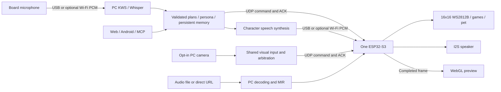

# Intelligent Lighting Control System — Pro

**2026-11-05 final Pro software audit:** the system can enter controlled first hardware validation with the [explicitly verified runtime profile](docs/PRO_HARDWARE_READINESS.md). Default local GPU/cuDNN speech still fails; the compatible profile uses CPU ASR and CUDA TTS without cuDNN, with an isolated dependency overlay. Core APK controls and startup health were repaired. This is not hardware/product acceptance or a promise of Mid-level latency. [Requirements](docs/PRO_FINAL_REQUIREMENTS_BASELINE.md) · [51-capability audit](docs/PRO_FINAL_FEATURE_AUDIT.md). Arcade remains100 registered/56 success paths; remaining polish is nonblocking P2.

**2026-11-05 Phase C software review:** 100/100 remain registered; 56 have recorded C++/Python success or survival-goal input paths, while 44 still lack that certification. All 100 have actual title/play/terminal renderer captures (some terminals are losses). Tron sounds, Memory Match shuffle, Portal/Nim/Firefighter challenge structure, Mario lifecycle and score/progress reporting were corrected. 55 games still expose only generic lifecycle sounds; four unseeded cross-backend RNG comparisons need review. No phone/LED/listening or final product certification. [Per-game review](docs/ARCADE_PHASE_C.md) · [Deployment readiness, no flashing performed](docs/ARCADE_PHASE_C_HARDWARE_READINESS.md).

**2026-11-04 Phase B3:** **100/100 target games are now registered in C++ and Python.** The remaining 36 have 216 input-only win/loss rounds across three difficulty tiers, replayed in production C++ with key-state comparisons. All 100 pass basic host lifecycle/bounds and simulated HTTP integration; APK 2.0.0 and ESP-IDF build passed. Physical phone/LED/audio acceptance and final product quality remain pending. [Per-game scope and evidence](docs/ARCADE_PHASE_B3.md). Earlier entries below are historical milestones.

**2026-11-04 Phase B2:** five new targets (035/057/058/081/098) bring the registry to **64/100**. Three-tier input-only full rounds, Mirror Laser's four stages and bounded short-write/priority audio policies have software evidence; physical acceptance remains pending. [Scope](docs/ARCADE_PHASE_B2.md).

**2026-11-04 Phase B1:** fixed-step timing and nonblocking shared sound infrastructure; 017/085/092/095 have three real difficulty tiers and full-round host checks. Registry remains 59; physical/audio acceptance pending. [Details](docs/ARCADE_PHASE_B1.md).

**2026-11-04 handoff / A.1:** 59 target cartridges are software-integrated; 41 remain unregistered. Disposable readback lanes, explicit Pong player selection and safe first-pair retries are implemented. See [scope and acceptance boundaries](docs/ARCADE_HANDOFF_A1.md). Physical tests remain pending.

A local PC voice agent and one ESP32-S3 drive a 16×16 light matrix, a Kurisu pixel pet and matrix games.

[简体中文](README_ZH.md) · **English** · [日本語](README_JA.md)

**2026-11-04 Phase A:** the arcade development branch adds paired Android-to-ESP32 UDP control and restricts PC Web access by default. See [pairing, migration and validation boundaries](docs/PHASE_A_NETWORK.md) before updating clients or enabling LAN access. Physical phone/board acceptance remains pending.

**2026-10-25: one responsive Amadeus interface now serves desktop and mobile.** `/` contains Overview, Lights, Music, Interaction and Settings; `/pro.html` redirects to it. Android packages the same web source. [UI details and validation limits](docs/UNIFIED_WEB.md) · [APK build](android-app/README.md).

**2026-10-24: source and offline checks are supplemented by limited board records; full-system hardware acceptance remains incomplete.** The [current implementation and deployment guide](docs/PRO_FEATURES.en.md) maps all 18 historical requirements to code and explicitly records differences.

## Current implementation

| Area | Implementation |
| --- | --- |
| Firmware | Native RMT DMA, single 16×16 panel addressing (straight rows on the currently measured panel; serpentine optional), shared display lock, completed PWM frame snapshots and optional gamma. |
| Voice and agent | PC acoustic KWS plus Whisper confirmation, validated semantic plans for the mode catalog, local Ollama persona and bilingual GPT-SoVITS replies. Continuous turns end on idle timeout or an explicit closing phrase. |
| Memory | Persistent SQLite facts, preferences, conversation and chunked reference documents; deletable RAG with lexical vectors or a configured local embedding model. |
| Vision | One camera owner, fingertip tracking, pinch/throw physics, calibrated gaze, approximate head pose, presence/fatigue/smile cues and pet life states. |
| Local music | Search the PC library and request songs by web/voice, with previous/next, shuffle/repeat, board speaker playback and the music halo. No SD card required. [Guide](docs/LOCAL_MUSIC.en.md). |
| Interaction | Existing effects and games, worldline digits, countdown completion signal, pixel canvas, MIR wave field, ambient mode, gesture/gaze games and bounded manual/adaptive difficulty. |
| Protocols and UI | UDP ACK control; existing USB audio and optional bidirectional Wi-Fi PCM; MCP HTTP/WS and a separate XiaoZhi v1 Opus adapter; pixel editor, PWM-driven WebGL preview and configurable Android host/DNS-SD discovery. |
| Offline preview | A clearly labelled simulation service can execute the real C++ engines compiled to WASM. |



Direct modes are 0–31 except 18 and 25. Countdown mode 25 requires a duration. New modes 26–31 are fingertip, sandbox, worldline, canvas, music fluid and ambient. The accepted idle pet palette and user pixel overrides are retained.

## Run and validation

Install `pc-agent-vision/requirements-pro.txt`; voice/model resources require their documented separate setup. For a device-free preview, set external task cache/data paths as described in the guide, then run:

```powershell
python -B pc-agent-vision/web_server.py --simulate --no-audio --port 8086
```

Open `http://127.0.0.1:8086/`. This path does not discover hardware, load models, capture sensors or play sound. Full animated simulation requires building the WASM engine and setting `KURISU_RENDERER_WASM`; otherwise only limited static fixtures are provided.

Offline validation covers a complete ESP-IDF build, Python runtime/protocol and voice regressions, real C++ engine tests, real Opus encode/decode, browser simulation checks and Android compilation/signature verification. **Those offline checks involved no device operation. Later board receipts and audio-sample checks are documented separately and do not establish full-system acceptance.** Generated binaries, APKs, logs and models are excluded from commits.

## Design differences and attribution

The original SRS is not implemented verbatim: Pro still uses PC wake detection rather than native board WakeNet; countdown uses a pixel progress display rather than granular physics; music is converted to 16 kHz mono; WebGL is a visual approximation rather than a calibrated optical twin. Duplex/AEC, gaze/expression heuristics, DDA and discovery need later physical validation. No new zero-CPU, stable-60-FPS, latency or recognition-accuracy result is claimed.

Maintained by **Chaoran Liu / 刘超然**. The teammate-provided fingertip module is now integrated. Third-party frameworks, pretrained models and character assets retain their original ownership/licensing; integration is not original model training. There is no repository-wide LICENSE file.

[Current guide](docs/PRO_FEATURES.en.md) · [Fingertip integration](INTEGRATION.md) · [Historical audio baseline](docs/VOICE_CONTROL_RECOVERY.md) · [Historical panel acceptance](docs/MATRIX_16X16_VALIDATION.md)

2026-10-24 delivery enables IPv4 reassembly for full-canvas commands and PCM TCP_NODELAY, warms the model before automatic listening, and stores generated wake keywords in the task cache. See [limited board records](docs/hardware-checks-20261023.en.md) and [current deployment requirements](docs/PRO_FEATURES.en.md); full-system acceptance remains incomplete.
