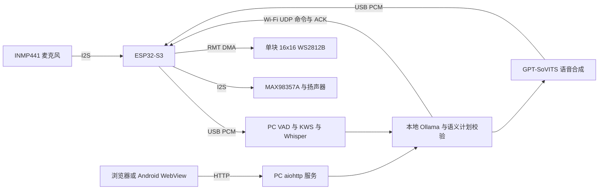

# Intelligent Lighting Control System — Pro

PC 本地语音智能体与 ESP32-S3 协同的交互灯板、像素桌宠及点阵游戏平台。

**简体中文** · [English](README_EN.md) · [日本語](README_JA.md)

**深入阅读：** [源码与架构](docs/technical-notes.zh-CN.md#source-map) · [语音与语义控制](docs/technical-notes.zh-CN.md#voice-agent) · [显示与游戏](docs/technical-notes.zh-CN.md#display) · [视觉与频谱](docs/technical-notes.zh-CN.md#vision-audio) · [实现范围](docs/technical-notes.zh-CN.md#implementation-status) · [部署操作](docs/setup.zh-CN.md)

Pro 是 **Basic → Mid → Pro** 系列的高阶开发项目。PC 运行声学唤醒、语音识别、本地语言模型、语义计划与语音合成；ESP32-S3 集中执行 LED 显示、I2S 麦克风／扬声器、游戏和倒计时。浏览器及 Android WebView 客户端通过 PC 服务操作设备。

相较于 [Basic](https://github.com/DongFengPo1412/Intelligent-Lighting-Control-System-Basic) 的固定离线词条，以及 [Mid](https://github.com/DongFengPo1412/Intelligent-Lighting-Control-System-Mid) 的双 ESP32 与 Jetson 架构，Pro 将灯板执行统一到单颗 S3，把模型计算移至 PC，并为控制加入板端回执与重复请求处理。

## 当前架构与数据流

**控制走 Wi-Fi UDP，板载语音音频仍走 USB。** WebSocket 用于 PC 与浏览器间的事件通知，不是板端音频通道。当前语音是单轮交互：唤醒后执行一条指令，再回到等待唤醒；没有边说边听的全双工对话。

## 已实现的核心模块

| 模块 | 具体实现 | 当前边界 |
| :--- | :--- | :--- |
| **统一灯板执行** | ESP-IDF `led_strip` 的 RMT 驱动启用 DMA；共享逐行蛇形映射；显示任务运行于 Core 1。 | 应用使用单个 RGB 缓冲区，普通模式含 33 ms 任务延时；不宣称双缓冲、零 CPU 或稳定 60 FPS。 |
| **本地语音入口** | WebRTC VAD 分句，Sherpa ONNX KWS 声学门控，再由 faster-whisper `base` 确认与转写。 | 模型在 PC；唤醒词为“助手／红莉栖／克里斯／牧濑红莉栖”；10 s 等待指令窗口。 |
| **语义控制** | Ollama `kurisu`（基于 `qwen2.5:7b`）生成结构化计划，校验效果名、参数和矛盾动作，再分发工具。 | 完整字面命令可走快速路径；普通聊天不从回复文字中自动执行动作。当前没有 Mem0 或向量记忆库。 |
| **双语回复与播放** | GPT-SoVITS 外部角色权重、中文／日文合成、音频后处理及 32 kHz→16 kHz 重采样。 | 模型与参考音频需另行准备；不是本仓库自训练的语音模型，也不保证翻译或听感始终正确。 |
| **灯效、桌宠与计时** | 经典显示预设、火焰、代码雨；四帧桌宠按播放状态开合嘴和随机眨眼；按经过时间减少点亮像素。 | 桌宠口型不是音素对齐；计时结束有约 1.5 s 提示动画，不是物理沙粒仿真。 |
| **游戏与控制端** | 贪吃蛇、俄罗斯方块；Web 模式／亮度／音量／倒计时／游戏按钮；Android WebView 封装。 | 网页是 2D 独立模拟，非逐帧硬件镜像；游戏速度由分数／消行改变，没有基于表情的 DDA。 |

视觉手势、人脸登记和 PC 音频输入频谱另有可启动程序；它们没有被默认 Web 服务统一调度。具体功能、依赖和未接入部分见[技术说明](docs/technical-notes.zh-CN.md#vision-audio)。

## 关键工程设计

- **可确认的控制链路：** 每条 PC 请求带 `request_id`；板端返回模式、计时及音频统计。相同请求重试可复用缓存结果，避免倒计时重启或游戏动作重复。
- **语义与执行分离：** 将效果目录、数值设置、普通聊天和待澄清意图区分，限制动作数量与参数范围；无效模型计划最多自修正一次，板端未确认就不播报成功。
- **音频接收与输出解耦：** USB 二进制帧进入 32 KiB 环形缓冲，由独立播放任务写入 I2S。PC 对比接收／写入采样数、丢弃和错误计数，避免把发送成功当作播放成功。
- **源图与实物配色分离：** 保存独立的 256 格图像基准、显示部位覆盖与 LED 驱动配方；以生成一致性检查保护用户修订，同时保留尚未通过目视验收的配色状态。

[协议、公式与实现取舍](docs/technical-notes.zh-CN.md) · [历史音频修复](docs/VOICE_CONTROL_RECOVERY.md) · [单块面板验证](docs/MATRIX_16X16_VALIDATION.md)

## 验证结果与范围

| 依据 | 已有结果 | 适用范围 |
| :--- | :--- | :--- |
| 既有离线记录 | 22 项交互回归、6 项语义计划检查、11 项配色检查及两个 C++ 编译期检查通过。 | 使用替身或静态数据，不代表完整服务或硬件实测。 |
| 历史单块面板记录 | 构建／烧录、板端 ACK，以及四角、逐行、非对称图形和多模式的用户确认。 | 对应当时固件与样机；不是全面时序或功耗评测。 |
| 历史语音与语义记录 | 固定 30 条本地模型用例通过；两条真实语音完成星空／波纹控制并获用户确认。 | 小样本记录，不是总体识别准确率或长期误唤醒率。 |
| 当前桌宠配色记录 | 完整固件与回执可核对；深棕外框目标仍未达到，四相闪烁实验已弃用。 | 数字检查、写入成功与视觉验收是不同结果。 |

本轮未重新烧录、启动完整语音服务或进行硬件声光测试。CPU 利用率、端到端延迟、TTFT、色度与供电容量均无受控基准，本页不提供此类性能成绩。[验证依据和未解决问题](docs/technical-notes.zh-CN.md#implementation-status)

## 快速开始

1. 依[硬件表](docs/setup.zh-CN.md#hardware)核对单块 16×16 灯板、INMP441、MAX98357A 与 USB／电源连接。
2. 复制 `firmware-s3/main/wifi_config.example.h` 为同目录忽略跟踪的 `wifi_config.private.h`，填写自己的网络参数。
3. 用 ESP-IDF 构建完整应用，显式关闭面板／配色诊断入口。当前依赖宣告 IDF>=5.0，最近已有构建记录使用 **v5.5.4**。
4. 准备 Python、Ollama、ASR／KWS／TTS 模型及依赖，按[部署指南](docs/setup.zh-CN.md#pc)启动 `pc-agent-vision/web_server.py`。启动会初始化设备并可能发出提示音。
5. PC 浏览器打开 `http://localhost:8080`，手机使用启动日志中的 PC 局域网地址。先核对 `/api/status`，再测试实际功能。

## 实现范围、后续开发与归属

[18 项规格书](docs/HIGH_STAGE_SYSTEM_SPEC_18.md)是历史设计目标。当前没有完成视线／头姿控制、疲劳情绪识别、3D 抓投沙盒、手势／视线游戏控制、长期记忆、无线全双工音频、MIR 流体或 Three.js 数字孪生。已归位到 PC／固件目录的指尖源码是**待集成资料**，模式 26 和 `track` 尚未接入正式固件。

后续优先统一过时的客户端参数与状态显示，验证模式切换和游戏边界，固定可复现环境，再推进连续对话与视觉整合。项目由 **刘超然 / Chaoran Liu** 维护；框架、预训练模型与第三方素材应按来源归属，不把集成工作写成独立训练或原创模型算法。

[技术说明](docs/technical-notes.zh-CN.md) · [部署操作](docs/setup.zh-CN.md) · [开发流程](docs/DEVELOPMENT_WORKFLOW.md)

仓库目前没有独立的 `LICENSE` 文件，因此不沿用旧版 MIT 徽章作完整授权声明。ESP-IDF、`led_strip`、Qwen、Whisper、Sherpa ONNX、GPT-SoVITS、MediaPipe 等依赖，以及角色图像、语音和模型资源，分别以其来源的许可条件为准。

## 维护修订与验证

2026-10 维护版：频谱字段数、范围和失败返回经过校验，500 ms断流后目标归零并继续衰减，零值不再持续点亮底行或峰值。贪吃蛇修复食物避让、旧尾增长、满盘结束和每步方向提交，速度严格不低于80 ms；方块下落严格不低于100 ms。显示渲染、模式/游戏/频谱输入、亮度及计时状态共用递归互斥锁。

倒计时只能使用带1–86400整数秒的专用命令，直接模式选择为0–24、18除外；25不再接受为无时长切模。PC控制器、工具Schema和固件一致拒绝该用法。独立手势/频谱脚本改用Wi-Fi控制就绪状态，恢复亮度为合法值20；USB音频连接不再是这些控制动作的前置条件。仍是独立程序，没有统一摄像头或模式仲裁。

ESP-IDF 5.5.4在隔离副本完整编译通过，使用公开示例网络配置，镜像874800字节；11项真实C++显示引擎用例及9项Python控制/资源释放用例通过。C++测试使用假时钟/LED HAL，Python测试不连接串口、UDP、麦克风或模型。没有烧录、录音、发声或新的实机验收；历史听感和硬件记录不视为本修订版实测。
