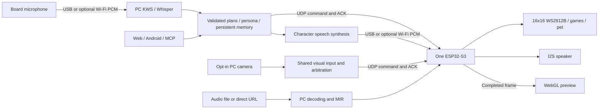

# Intelligent Lighting Control System — Pro

A local PC voice agent and one ESP32-S3 drive a 16×16 light matrix, a Kurisu pixel pet and matrix games.

[简体中文](README.md) · **English** · [日本語](README_JA.md)

**2026-10-23: the expanded feature set is implemented in source and checked offline; it has not been flashed or accepted on hardware.** The [current implementation and deployment guide](docs/PRO_FEATURES.en.md) maps all 18 historical requirements to code and explicitly records differences.

## Current implementation

| Area | Implementation |
| --- | --- |
| Firmware | Native RMT DMA, single-panel serpentine addressing, shared display lock, completed PWM frame snapshots and optional gamma. |
| Voice and agent | PC acoustic KWS plus Whisper confirmation, validated semantic plans for the mode catalog, local Ollama persona and bilingual GPT-SoVITS replies. Continuous turns end on idle timeout or an explicit closing phrase. |
| Memory | Persistent SQLite facts, preferences, conversation and chunked reference documents; deletable RAG with lexical vectors or a configured local embedding model. |
| Vision | One camera owner, fingertip tracking, pinch/throw physics, calibrated gaze, approximate head pose, presence/fatigue/smile cues and pet life states. |
| Interaction | Existing effects and games, worldline digits, countdown completion signal, pixel canvas, MIR wave field, ambient mode, gesture/gaze games and bounded manual/adaptive difficulty. |
| Protocols and UI | UDP ACK control; existing USB audio and optional bidirectional Wi-Fi PCM; MCP HTTP/WS and a separate XiaoZhi v1 Opus adapter; pixel editor, PWM-driven WebGL preview and configurable Android host/DNS-SD discovery. |
| Offline preview | A clearly labelled simulation service can execute the real C++ engines compiled to WASM. |



Direct modes are 0–31 except 18 and 25. Countdown mode 25 requires a duration. New modes 26–31 are fingertip, sandbox, worldline, canvas, music fluid and ambient. The accepted idle pet palette and user pixel overrides are retained.

## Run and validation

Install `pc-agent-vision/requirements-pro.txt`; voice/model resources require their documented separate setup. For a device-free preview, set external task cache/data paths as described in the guide, then run:

```powershell
python -B pc-agent-vision/web_server.py --simulate --no-audio --port 8086
```

Open `http://127.0.0.1:8086/pro.html`. This path does not discover hardware, load models, capture sensors or play sound. Full animated simulation requires building the WASM engine and setting `KURISU_RENDERER_WASM`; otherwise only limited static fixtures are provided.

Offline validation covers a complete ESP-IDF build, Python runtime/protocol and voice regressions, real C++ engine tests, real Opus encode/decode, browser simulation checks and Android compilation/signature verification. **No flashing, camera capture, recording, playback or Android installation was performed.** Generated binaries, APKs, logs and models are excluded from commits.

## Design differences and attribution

The original SRS is not implemented verbatim: Pro still uses PC wake detection rather than native board WakeNet; countdown uses a pixel progress display rather than granular physics; music is converted to 16 kHz mono; WebGL is a visual approximation rather than a calibrated optical twin. Duplex/AEC, gaze/expression heuristics, DDA and discovery need later physical validation. No new zero-CPU, stable-60-FPS, latency or recognition-accuracy result is claimed.

Maintained by **Chaoran Liu / 刘超然**. The teammate-provided fingertip module is now integrated. Third-party frameworks, pretrained models and character assets retain their original ownership/licensing; integration is not original model training. There is no repository-wide LICENSE file.

[Current guide](docs/PRO_FEATURES.en.md) · [Fingertip integration](INTEGRATION.md) · [Historical audio baseline](docs/VOICE_CONTROL_RECOVERY.md) · [Historical panel acceptance](docs/MATRIX_16X16_VALIDATION.md)
