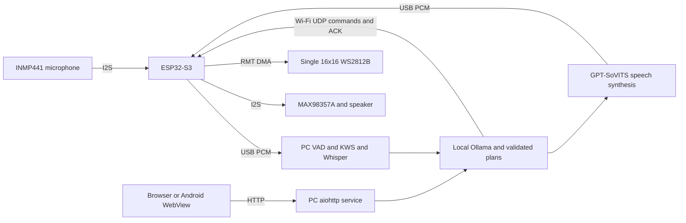

# Intelligent Lighting Control System — Pro

An interactive LED matrix, pixel companion, and game platform combining a local PC voice agent with ESP32-S3 execution.

[简体中文](README.md) · **English** · [日本語](README_JA.md)

**Explore:** [Source and architecture](docs/technical-notes.en.md#source-map) · [Voice and semantic control](docs/technical-notes.en.md#voice-agent) · [Display and games](docs/technical-notes.en.md#display) · [Vision and spectrum](docs/technical-notes.en.md#vision-audio) · [Implementation scope](docs/technical-notes.en.md#implementation-status) · [Setup](docs/setup.en.md)

Pro is the advanced development project in **Basic → Mid → Pro**. The PC runs acoustic wake detection, ASR, a local language model, semantic planning, and speech synthesis. One ESP32-S3 handles LEDs, I2S microphone/speaker interfaces, games, and countdowns. Browser and Android WebView clients operate through the PC service.

Compared with [Basic](https://github.com/DongFengPo1412/Intelligent-Lighting-Control-System-Basic)'s fixed offline vocabulary and [Mid](https://github.com/DongFengPo1412/Intelligent-Lighting-Control-System-Mid)'s dual-ESP32/Jetson architecture, Pro consolidates display execution on one S3, moves model computation to the PC, and adds board acknowledgements and duplicate-request handling.

## Current architecture and data flow

**Control uses Wi-Fi UDP; board audio still uses USB.** WebSocket carries PC/browser events, not board audio. Voice interaction is single-turn: wake, execute one command, then wait for another wake. Simultaneous listening and speaking is not implemented.

## Implemented core modules

| Module | Implementation | Current boundary |
| :--- | :--- | :--- |
| **Unified display execution** | ESP-IDF `led_strip` RMT with DMA, shared row-serpentine mapping, display task on Core 1. | One application RGB buffer; ordinary modes include a 33 ms task delay. No double-buffer, zero-CPU, or stable-60-FPS claim. |
| **Local voice input** | WebRTC VAD segmentation, Sherpa ONNX KWS acoustic gating, then faster-whisper `base` confirmation/transcription. | Models run on the PC; wake phrases are 助手/红莉栖/克里斯/牧濑红莉栖, followed by a 10 s command window. |
| **Semantic control** | Ollama `kurisu`, based on `qwen2.5:7b`, produces plans validated against effect names, parameters, and contradictory actions. | Complete literal commands can bypass the model. Chat prose cannot trigger actions. No Mem0 or vector memory store. |
| **Bilingual replies/playback** | External GPT-SoVITS character checkpoints, Chinese/Japanese synthesis, post-processing, and 32 kHz→16 kHz resampling. | Models/reference audio require separate preparation; no project-owned model training or guarantee of translation/listening quality. |
| **Effects, companion, timer** | Display presets, fire, code rain; four companion frames with speaker-state mouth animation and random blinking; elapsed-time pixel countdown. | Mouth animation is not phoneme alignment; completion includes about 1.5 s of feedback animation, not simulated sand physics. |
| **Games and clients** | Snake/Tetris; Web mode/brightness/volume/timer/game controls; Android WebView wrapper. | Browser display is an independent 2D simulation, not pixel readback. Game speed follows score/lines, without facial-state DDA. |

Gesture control, face enrollment, and PC-input spectrum analysis have separate runnable programs. The default Web service does not orchestrate them. See [technical notes](docs/technical-notes.en.md#vision-audio) for dependencies and integration boundaries.

## Engineering design

- **Acknowledged control:** PC requests carry a `request_id`; board replies include mode, countdown, and audio counters. Cached duplicate results allow retries without restarting a timer or repeating a game move.
- **Separate planning and execution:** effect catalogs, numeric settings, chat, and clarification have distinct paths. Action counts and ranges are checked; one repair attempt is allowed for invalid model plans, and unacknowledged operations are not announced as successful.
- **Decoupled audio reception/output:** USB binary frames enter a 32 KiB ring buffer consumed by an I2S playback task. PC checks received/written sample deltas and drop/error counters rather than treating transmission as playback.
- **Separate design pixels and LED recipes:** an independent 256-cell reference, role overrides, and LED drive recipes preserve user revisions through generator checks while retaining the unresolved visual-acceptance status.

[Protocols, equations, and tradeoffs](docs/technical-notes.en.md) · [Historical audio repair](docs/VOICE_CONTROL_RECOVERY.md) · [Single-panel validation](docs/MATRIX_16X16_VALIDATION.md)

## Validation and scope

| Evidence | Result | Scope |
| :--- | :--- | :--- |
| Earlier offline records | 22 interaction regressions, 6 planning tests, 11 palette checks, and two C++ compile-time checks passed. | Mocks/static data; not a complete service or hardware test. |
| Historical single-panel record | Build/flash logs, board ACKs, and user confirmation of corners, row scanning, asymmetric patterns, and multiple modes. | The recorded firmware/prototype, not comprehensive timing or power evaluation. |
| Historical voice/semantic record | Thirty fixed local-model cases passed; two real voice commands operated stars/ripples with user confirmation. | Small samples, not overall ASR accuracy or long-term false-wake rates. |
| Current companion-color record | Complete firmware and ACK records are available; dark-brown outline remains unmet, and four-phase flickering was rejected. | Numeric checks, successful flashing, and visual acceptance are distinct results. |

This pass did not reflash, launch the full voice service, or retest physical audio/display behavior. CPU utilization, end-to-end delay, TTFT, colorimetry, and supply capacity lack controlled benchmarks and are not reported as measured results. [Evidence and outstanding issues](docs/technical-notes.en.md#implementation-status)

## Quick start

1. Check the single 16×16 panel, INMP441, MAX98357A, USB, and power connections against the [hardware table](docs/setup.en.md#hardware).
2. Copy `firmware-s3/main/wifi_config.example.h` to ignored `wifi_config.private.h` in the same directory and supply your network settings.
3. Build the complete ESP-IDF application with both panel/color diagnostics explicitly disabled. The manifest declares IDF>=5.0; recent recorded builds use **v5.5.4**.
4. Prepare Python, Ollama, ASR/KWS/TTS models and dependencies, then launch `pc-agent-vision/web_server.py` following [setup](docs/setup.en.md#pc). Startup initializes the device and may play a chime.
5. Open `http://localhost:8080` on the PC or the logged PC LAN address on a phone. Check `/api/status` before exercising functions.

## Scope, further work, and attribution

The [18-item specification](docs/HIGH_STAGE_SYSTEM_SPEC_18.md) records historical design targets. Gaze/head-pose control, fatigue classification, a 3D grasp/throw sandbox, gesture/gaze game steering, long-term memory, wireless full-duplex audio, MIR fluids, and a Three.js digital twin are not completed. Root-level fingertip sources are **pending integration**; mode 26 and `track` are absent from production firmware.

Next work is to reconcile outdated client parameters/status displays, verify mode transitions and game edge cases, pin a reproducible environment, and then develop continuous conversation and vision integration. **Chaoran Liu / 刘超然** maintains the project. Frameworks, pretrained models, and third-party assets retain their attribution; integration is not presented as original model training or algorithm invention.

[Technical notes](docs/technical-notes.en.md) · [Setup](docs/setup.en.md) · [Development workflow](docs/DEVELOPMENT_WORKFLOW.md)

No standalone `LICENSE` file currently exists, so the old MIT badge is not retained as a complete licensing statement. ESP-IDF, `led_strip`, Qwen, Whisper, Sherpa ONNX, GPT-SoVITS, MediaPipe, character images/audio, and model resources remain subject to their respective source licenses.

## Maintenance and validation

The 2026-10 revision validates spectrum fields/ranges and propagates rejection. After 500 ms without input, targets clear and decay continues; zero values no longer keep bottom pixels/peak markers lit. Snake fixes food exclusion, old-tail growth, full-board completion and once-per-tick direction application with a strict 80 ms speed floor. Tetris has a strict 100 ms floor. Rendering, mode/game/spectrum input, brightness and timer state share a recursive mutex.

Countdown requires its dedicated command with integer duration 1–86400 seconds. Direct modes are 0–24 except 18; selecting 25 without duration is rejected consistently by the PC controller, tool schema and firmware. Independent gesture/spectrum scripts now check Wi-Fi control readiness and restore legal brightness 20, without requiring a USB audio connection. They remain standalone programs without unified camera/mode arbitration.

An isolated ESP-IDF 5.5.4 build with public example network configuration succeeds; the image is 874800 bytes. Eleven real C++ engine cases and nine Python control/resource-release cases pass. C++ uses a fake clock/LED HAL; Python does not connect serial, UDP, microphones or models. No flashing, recording, audible output or new hardware acceptance occurred. Historical listening/hardware records do not validate this revision.
