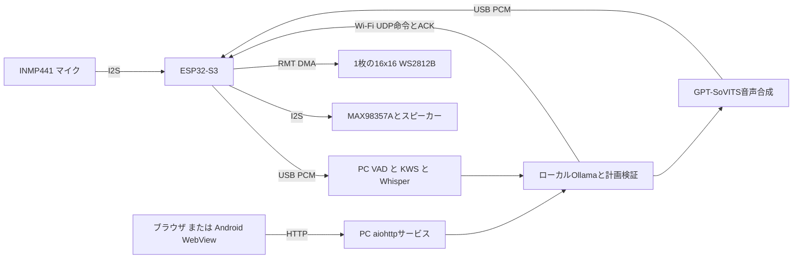

# Intelligent Lighting Control System — Pro

PC上のローカル音声エージェントとESP32-S3を連携させる、LEDパネル・ピクセルキャラクター・ゲームの開発プラットフォームです。

[简体中文](README.md) · [English](README_EN.md) · **日本語**

**詳細：** [ソースと構成](docs/technical-notes.ja.md#source-map) · [音声と意味解析](docs/technical-notes.ja.md#voice-agent) · [描画とゲーム](docs/technical-notes.ja.md#display) · [視覚とスペクトル](docs/technical-notes.ja.md#vision-audio) · [実装範囲](docs/technical-notes.ja.md#implementation-status) · [導入](docs/setup.ja.md)

Proは**Basic → Mid → Pro**の上級開発プロジェクトです。PCで音響ウェイク検出、音声認識、ローカル言語モデル、意味解析、音声合成を実行し、ESP32-S3がLED、I2Sマイク／スピーカー、ゲーム、カウントダウンを担当します。ブラウザとAndroid WebViewはPCサービス経由で操作します。

定型オフライン語彙の[Basic](https://github.com/DongFengPo1412/Intelligent-Lighting-Control-System-Basic)、ESP32 2台とJetsonを使う[Mid](https://github.com/DongFengPo1412/Intelligent-Lighting-Control-System-Mid)から発展し、表示を1台のS3へ統合、モデル処理をPCへ移し、応答確認と重複要求処理を追加しました。

## 現在の構成とデータ経路

**制御はWi-Fi UDP、基板の音声は引き続きUSBです。** WebSocketはPCとブラウザ間のイベント通知で、基板の音声経路ではありません。現在はウェイク後に1命令を処理して待機へ戻る単発対話で、発話中の同時聴取は実装していません。

## 実装済みの主要モジュール

| モジュール | 実装 | 現在の制約 |
| :--- | :--- | :--- |
| **表示の統合** | ESP-IDF `led_strip`のRMTでDMAを有効化し、共通蛇行変換とCore 1描画タスクを使用。 | アプリRGBバッファは1個、通常表示に33 ms待機。ダブルバッファ、CPUゼロ、安定60 FPSとは主張しません。 |
| **ローカル音声入力** | WebRTC VADで分割、Sherpa ONNX KWSで音響ゲート、その後faster-whisper `base`で確認・転写。 | PCで実行。語は助手／红莉栖／克里斯／牧濑红莉栖、命令待ちは10 sです。 |
| **意味解析制御** | `qwen2.5:7b`に基づくOllama `kurisu`の計画を、効果名・引数・矛盾で検証して実行。 | 完全な定型命令は直接処理。雑談文から自動実行せず、Mem0やベクトル記憶はありません。 |
| **二言語応答と再生** | 外部GPT-SoVITSキャラクター重み、中国語／日本語合成、後処理、32 kHz→16 kHz変換。 | モデルと参照音声は別途準備。本リポジトリで独自学習した音声モデルではなく、翻訳・聴感の完全性も保証しません。 |
| **照明・キャラクター・計時** | 表示設定、炎、コード雨。4フレームで再生状態の口パクとランダム瞬き、経過時間に応じた消灯。 | 音素同期ではなく、終了時は約1.5 sの提示アニメーション。物理的砂粒の計算ではありません。 |
| **ゲームと操作端末** | スネーク／テトリス、Webのモード・輝度・音量・計時・ゲーム操作、Android WebView。 | Web表示は独立2Dシミュレーションで、ピクセル読戻しではありません。速度は得点・行数で変化し、表情に基づくDDAはありません。 |

ジェスチャ、顔登録、PC音声入力のスペクトルには個別実行プログラムがあります。既定Webサービスはこれらを統合起動しません。依存と未接続部分は[技術ノート](docs/technical-notes.ja.md#vision-audio)を参照してください。

## 主な設計

- **応答を確認する制御：** PCの各要求に`request_id`を付け、基板はモード・計時・音声統計を返します。重複結果のキャッシュにより、再送でタイマーやゲーム操作を繰り返さないようにします。
- **計画と実行の分離：** 効果一覧、数値設定、雑談、要確認を分け、操作数と引数範囲を検査します。不正計画の修正は1回までとし、ACKなしでは成功を読み上げません。
- **音声受信と出力の分離：** USBフレームを32 KiBリングバッファへ入れ、別タスクでI2Sへ書きます。PCは受信・書込・破棄・エラー数を照合し、送信完了だけを再生成功と扱いません。
- **原画とLED配色の分離：** 独立した256画素基準、部位上書き、LED出力配色設定を生成器で確認し、ユーザーによる修正を保護します。未達の色の目視評価も記録します。

[プロトコル・数式・設計上の選択](docs/technical-notes.ja.md) · [過去の音声修正](docs/VOICE_CONTROL_RECOVERY.md) · [1枚パネル検証](docs/MATRIX_16X16_VALIDATION.md)

## 検証結果と範囲

| 根拠 | 結果 | 適用範囲 |
| :--- | :--- | :--- |
| 以前のオフライン記録 | 対話・制御の回帰22件、計画6件、配色11件、C++コンパイル時検査2本が通過。 | モック・静的データによる確認で、全サービスや実機試験ではありません。 |
| 過去の1枚パネル記録 | ビルド・書込み・ACK、四隅・行走査・非対称図形・複数モードのユーザー確認。 | 当時のファームウェアと試作機。包括的なタイミング・消費電力測定ではありません。 |
| 過去の音声・意味解析記録 | 固定30例のローカルモデル試験、星／波紋の実音声2命令をユーザーが確認。 | 小規模な記録で、全体認識率や長期誤ウェイク率ではありません。 |
| 現在のキャラクター配色記録 | 完全ファームウェアとACKの記録あり。濃い茶色の輪郭は未達、4相点滅実験は不採用。 | 数値検査、書込み成功、目視合格は別の結果です。 |

今回は再書込み、完全音声サービス起動、実機の音・光試験は行っていません。CPU負荷、端末間遅延、TTFT、色度、電源容量の統制評価はなく、測定成果として掲載しません。[根拠と残課題](docs/technical-notes.ja.md#implementation-status)

## クイックスタート

1. [ハードウェア表](docs/setup.ja.md#hardware)で1枚16×16、INMP441、MAX98357A、USB・電源を確認します。
2. `firmware-s3/main/wifi_config.example.h`を同じ場所の追跡対象外`wifi_config.private.h`へコピーし、自分のネットワークを設定します。
3. パネル・配色診断を明示的に無効化してESP-IDFの完全アプリを構築します。依存宣言はIDF>=5.0、最近の既存記録は**v5.5.4**です。
4. Python、Ollama、ASR／KWS／TTSモデルを準備し、[導入ガイド](docs/setup.ja.md#pc)で`pc-agent-vision/web_server.py`を起動します。起動はデバイスを初期化し、確認音が鳴る場合があります。
5. PCは`http://localhost:8080`、スマートフォンはログのPC LANアドレスを開き、先に`/api/status`を確認します。

## 実装範囲・今後の作業・帰属

[18項仕様](docs/HIGH_STAGE_SYSTEM_SPEC_18.md)は過去の設計目標です。視線・頭部姿勢、疲労分類、3D把持投擲、手／視線ゲーム操作、長期記憶、無線全二重音声、MIR流体、Three.jsデジタルツインは未完成です。ルートの指先ソースは**統合待ち資料**で、正式ファームウェアに26／`track`はありません。

次は古いクライアント引数・状態表示の整合、モード遷移とゲーム境界の確認、再現環境の固定を優先し、その後連続対話・視覚統合を進めます。**刘超然 / Chaoran Liu**が管理します。既存基盤、事前学習モデル、第三者素材は出典に帰属し、統合を独自学習や新規モデルアルゴリズムとは扱いません。

[技術ノート](docs/technical-notes.ja.md) · [導入](docs/setup.ja.md) · [開発手順](docs/DEVELOPMENT_WORKFLOW.md)

現在独立した`LICENSE`ファイルがないため、旧MITバッジを完全な許諾表示として引き継ぎません。ESP-IDF、`led_strip`、Qwen、Whisper、Sherpa ONNX、GPT-SoVITS、MediaPipe、キャラクター画像・音声・モデルはそれぞれの出典の条件に従います。

## 保守と検証

2026-10版では周波数項目・範囲を検査し、拒否を呼出し元へ返します。500 msの断流後は目標をゼロにして減衰し、ゼロ入力で底行・ピークを点灯し続けません。Snakeは食物回避、旧末尾保持、満盤終了、各ステップ1回の方向確定を修正し、80 msを厳密下限としました。Tetrisは100 msを下限とし、描画、モード・ゲーム・周波数入力、輝度、計時を共通の再帰ミューテックスで保護します。

倒計時は1–86400の整数秒を指定する専用命令を使います。直接モードは0–24のうち18を除き、時間なしの25はPC・ツールSchema・ファームウェアで拒否します。独立のジェスチャー・周波数スクリプトはWi-Fi制御状態を確認し、有効な輝度20へ戻します。USB音声接続は制御の前提ではありませんが、カメラ・モードの統一調停は未実装です。

公開ネットワーク例を使った隔離ESP-IDF 5.5.4ビルドが成功し、イメージは874800バイトです。実C++エンジン11件とPython制御・資源解放9件が通過しました。C++は模擬時計・LED HAL、Pythonはシリアル・UDP・マイク・モデル未接続です。書込、録音、発音、新たな実機受入試験は行っておらず、過去の聴感・実機記録は本修正版の評価ではありません。
