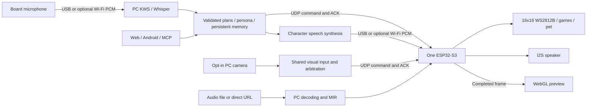

# Intelligent Lighting Control System — Pro

PCのローカル音声エージェントと1台のESP32-S3による、16×16 LED、紅莉栖のピクセルペット、ドットマトリクスゲームの開発プロジェクトです。

[简体中文](README.md) · [English](README_EN.md) · **日本語**

**2026-10-24：ソース・オフライン検証に加え、限定的な実機記録があります。全機能の実機受入は未完了です。** [現在の実装・導入ガイド](docs/PRO_FEATURES.ja.md)に、過去の18項目とコードの対応、設計上の相違を記載しています。

## 現在の実装

| 機能 | 実装 |
| --- | --- |
| 基盤 | RMT DMA、単一16×16パネルの座標変換（現在の実機は各行同方向、蛇行配線も選択可能）、表示状態の共通ロック、完成PWMフレームの取得、任意のGamma変換。 |
| 音声・対話 | PCでKWS＋Whisper確認、検証付き意味計画、Ollamaのキャラクター設定、GPT-SoVITSの中日応答。応答後も受付を続け、無操作時間または終了句で待機に戻ります。 |
| 長期記憶 | SQLiteによる事実・好み・会話の保存、資料分割、削除可能なRAG。既定は語彙検索、ローカルembeddingモデルも設定できます。 |
| 視覚 | カメラ所有者の統一、指先追跡、つまみ・投擲・反発、校正付き視線、近似頭部姿勢、在席・疲労・微笑の手がかりとペットの生活状態。 |
| 表示・ゲーム | 既存効果・ゲーム、世界線数字、終了通知、ピクセル編集、MIR波動、環境光、視線／手振り操作、手動／適応難度。 |
| 通信・UI | UDP ACK、既存USB音声と任意の双方向Wi-Fi PCM、MCP HTTP/WS、独立した小智v1 Opusアダプター、WebGL、設定可能なAndroid接続先とDNS-SD。 |
| 実機なしの表示 | 正式C++エンジンをWASM化して動かせる、明示的なシミュレーション環境。 |



直接選べるモードは0〜31（18と25を除く）です。25のタイマーには時間指定が必要です。26〜31は指先、サンドボックス、世界線、キャンバス、音楽流体、環境光です。待機ペットの既存配色とユーザー指定画素を維持しています。

## 実行と検証

`pc-agent-vision/requirements-pro.txt`を使用し、音声・モデル資源は別途準備します。ガイドに従ってリポジトリ外のタスク専用キャッシュ／データパスを設定し、次のコマンドで実機なしのプレビューを起動できます。

```powershell
python -B pc-agent-vision/web_server.py --simulate --no-audio --port 8086
```

`http://127.0.0.1:8086/pro.html`を開きます。この経路では機器探索、モデル読込、カメラ・マイク取得、再生を行いません。実際のC++アニメーションにはWASMのビルドと`KURISU_RENDERER_WASM`の設定が必要です。未設定では限定的な静的サンプルのみです。

検証はESP-IDF全体ビルド、Pythonの実行時・通信・音声回帰、実際のC++エンジン、Opus符号化／復号、ブラウザー上の模擬操作、Androidコンパイルと署名確認です。**上記のオフライン検証では機器を操作していません。その後の実機応答・音声サンプル確認は別途記録し、全機能の受入完了とは区別します。** 生成物・モデル・キャッシュはコミットしません。

## 設計上の相違と帰属

過去SRSをそのまま全項目達成したわけではありません。Proの起動語判定はPC側で、板上WakeNetではありません。タイマーは粒子物理ではなく画素進捗、音楽は16kHzモノラルに変換、WebGLは測光校正済みのデジタルツインではなく可視化です。双方向音声／AEC、視線・表情の手法、DDA、サービス探索は後日の実機評価が必要です。CPUゼロ、安定60FPS、遅延、認識精度の新たな測定結果は主張しません。

保守：**刘超然 / Chaoran Liu**。チームメンバーの指先モジュールを正式統合しました。外部フレームワーク・事前学習モデル・キャラクター素材の権利とライセンスは各提供元に帰属します。統合作業は独自モデル学習ではありません。独立したリポジトリ全体のLICENSEはありません。

[現在のガイド](docs/PRO_FEATURES.ja.md) · [指先の統合](INTEGRATION.md) · [過去の音声基準](docs/VOICE_CONTROL_RECOVERY.md) · [過去のパネル試験](docs/MATRIX_16X16_VALIDATION.md)

2026-10-24配布では全画布コマンドのIPv4断片再構成、PCM TCP_NODELAY、自動聴取前のモデル予熱、起動語生成先の専用キャッシュ化を行いました。[限定的な実機記録](docs/hardware-checks-20261023.ja.md)と[現行の導入条件](docs/PRO_FEATURES.ja.md)を参照してください。全機能の受入は未完了です。
