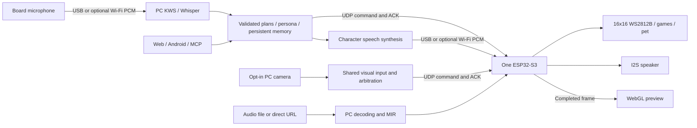

# Intelligent Lighting Control System — Pro

**2026-11-11 Pro v2.3.1 终极大师冻结版（Master Frozen Release）：**  
ESP32-S3 生产固件已完成全系统终极工程审计、缺陷闭环、单元与集成测试（2,090+ 项测试 100% 通过），并成功烧录至 COM9 开发板通过回读逐字节 SHA-256 校验，**固件正式彻底冻结**。所有硬件光影渲染、100合1街机、I2S音频、WiFi UDP/TCP、四态会话仲裁与通用 16×16 画布协议均已就绪。Jetson 组员可直接基于纯 Python 独立开发视觉模型与原创像素动画，**后续无需重新烧录 ESP32**。  
[全系统终审报告](docs/PRO_MASTER_FINAL_AUDIT.md) · [缺陷闭环报告](docs/PRO_MASTER_DEFECT_CLOSURE.md) · [51项主验收矩阵](docs/PRO_MASTER_ACCEPTANCE_MATRIX.csv) · [性能与时序报告](docs/PRO_MASTER_PERFORMANCE_REPORT.md) · [UI/UX审计](docs/PRO_MASTER_UI_UX_AUDIT.md) · [正式发布清册](docs/PRO_MASTER_RELEASE.md) · [组员交接指南](docs/PRO_MASTER_HANDOFF.md)。

**2026-11-05 整机软件收尾审计：** 采用[明确验证的兼容运行配置](docs/PRO_HARDWARE_READINESS.md)后，可进入经授权的首次受控上板验证。默认本机GPU/cuDNN语音仍有失败；兼容配置为CPU ASR、禁用cuDNN的CUDA TTS及隔离依赖覆盖。已修复APK基础灯控断链与启动假健康。不是实机/最终品质验收，不承诺中阶延迟。[最终需求](docs/PRO_FINAL_REQUIREMENTS_BASELINE.md) · [51项审计](docs/PRO_FINAL_FEATURE_AUDIT.md)。小游戏保持100注册/56成功路径，其余非阻断品质项列P2。

**2026-11-05 Phase C 软件审查：** 保持100/100注册；56款已有C++/Python成功完整局或生存目标输入证据，44款仍待补齐。100款均已导出开始/游玩/实际结算画面，部分结算为失败，不能据此认定通关。已修复Tron音效、翻牌随机性、传送门/Nim/消防挑战结构、Mario生命周期及计分/进度问题。55款仍只有通用生命周期音效；4款跨端随机源尚未统一认证。真实手机、LED、听音与最终产品品质均未验收。[逐款记录](docs/ARCADE_PHASE_C.md) · [部署准备，未刷写](docs/ARCADE_PHASE_C_HARDWARE_READINESS.md)。

**2026-11-04 Phase B3：100/100 正式目标已完成 C++/Python 软件注册。** 新增36款通过三档共216条仅按键胜负回放及生产C++关键状态对照；全部100款通过基础主机生命周期/边界与模拟HTTP集成，固件和2.0.0 APK构建通过。手机、LED、听音、延迟及最终精品品质仍待验。[逐款范围与证据](docs/ARCADE_PHASE_B3.md)。下方数字为历史阶段记录。

**2026-11-04 Phase B2：** 新增035/057/058/081/098，注册 **64/100**；完成五款三档完整局、镜面激光四关和音效短写/抢占策略的软件验证。实机、听音及延迟仍待验。[范围与证据](docs/ARCADE_PHASE_B2.md)。

**2026-11-04 Phase B1：** 新增固定步长与非阻塞共享音效，017/085/092/095 接通三档实际难度并通过完整局主机验证；注册数仍为59，实机和听音待验。[说明](docs/ARCADE_PHASE_B1.md)。

**2026-11-04 接续开发 / A.1：** 已接入 59 款目标卡带，其余 41 款未注册；新增独立回读通道、Pong 玩家模式命令及首次配对安全重试。[实现与验收边界](docs/ARCADE_HANDOFF_A1.md)。尚未进行手机、灯板及音效实机验收。

PC 本地语音智能体与单颗 ESP32-S3 协同的灯板、红莉栖桌宠和点阵游戏平台。

**简体中文** · [English](README.md) · [日本語](README_JA.md)

**2026-10-25：Web 与手机界面已统一为「Amadeus 光影实验室」。** 从 `/` 进入概览、灯光、音乐、互动和设置；旧 `/pro.html` 自动跳转。Android 直接打包同一份前端源码。[界面与验证范围](docs/UNIFIED_WEB.md) · [APK 构建](android-app/README.md)。

**2026-10-24：高阶功能已有代码、离线验证和部分板卡通信记录，全功能实机验收尚未完成。** [完整实现、18项需求差异与部署接口](docs/PRO_FEATURES.md)是当前说明；早期技术审计和实机记录保留为历史依据，不代表本轮新增功能的实测结果。

## 当前功能

| 模块 | 实现 |
| --- | --- |
| 灯板底座 | ESP-IDF RMT DMA、单块16×16映射（当前实测板每行同向，蛇形可选）、显示状态锁、完成帧PWM快照、可选Gamma。 |
| 语音与语义 | PC声学KWS＋Whisper确认、经过校验的全模式语义计划、Ollama角色对话、GPT-SoVITS中日回复；默认支持回复后继续听取，空闲或结束语退出。 |
| 长期记忆 | SQLite持久偏好与对话、资料分块、可删除的RAG；默认词汇检索，可配置本地embedding模型。 |
| 具身交互 | 统一摄像头入口，指尖追踪、捏合抓投／重力／碰撞波纹、校准视线、近似头姿、离席／疲劳／微笑提示与桌宠昼夜状态。 |
| 显示与游戏 | 原有灯效、表情、蛇与方块；数字世界线、计时结束提示、像素画布、MIR流体、环境微光、体感游戏、手动／自适应难度。 |
| 协议与客户端 | UDP ACK控制、既有USB音频、可选Wi-Fi双向PCM；MCP HTTP/WS、小智v1 Opus适配；像素编辑、PWM回读WebGL预览、Android服务器配置与局域网发现。 |
| 本地曲库 | 网页／语音点歌、歌名和歌手检索、上一首／下一首、随机与循环；电脑解码后由板载扬声器播放并驱动音乐光环，无需 SD 卡。[使用说明](docs/LOCAL_MUSIC.md)。 |
| 无硬件预览 | 明确标注的模拟服务，可运行从正式C++源码编译的离线WASM引擎。 |

直接模式为0–31、排除18和25；25必须传倒计时时长。26–31分别为指尖、光球、世界线、画布、音乐流体和环境微光。桌宠原待机配色及用户指定局部覆盖保留。

## 运行与验证

- 安装控制／Web／视觉依赖：`python -m pip install -r pc-agent-vision/requirements-pro.txt`。ASR、KWS、角色语音和Ollama模型需按[当前部署说明](docs/PRO_FEATURES.md#服务模型与数据)另行准备。
- 只看模拟控制台：`python -B pc-agent-vision/web_server.py --simulate --no-audio --port 8086`，打开 `http://127.0.0.1:8086/`。按[预览步骤](docs/PRO_FEATURES.md#完全离线的预览)设置仓库外缓存；不连接设备、不加载模型、不发声。
- 真实动画模拟另需构建WASM引擎并设置 `KURISU_RENDERER_WASM`；未配置时只有有限静态样例。完整硬件服务仍用同一入口，启动可能连接设备和发声，本轮没有启动该路径。

本轮验证包含ESP-IDF完整编译、Python协议／服务／语音回归、真实C++引擎离线执行、真实Opus编解码、浏览器模拟控制台检查、Android编译及签名核验。**上述离线验证未包含实机操作；后续板卡回执与音频样本检查单独记录，不代表全功能验收。** 生成镜像、APK、日志和缓存均不提交源码仓库。

## 原设计差异与归属

[18项历史SRS](docs/HIGH_STAGE_SYSTEM_SPEC_18.md)中的原生板端WakeNet、物理砂粒、原音乐规格无损与物理光照仿真没有按原样实现。当前采用PC唤醒、像素进度计时、16kHz单声道音乐和WebGL可视化；小智适配入口与Pro的PCM入口相互独立。全双工／AEC、视线／情绪启发式及DDA需要后续实机调试。没有零CPU、稳定60FPS、端到端时延或识别准确率的新测量结论。

项目由 **刘超然 / Chaoran Liu** 维护；组员指尖模块已接入正式工程。ESP-IDF、Qwen、Whisper、Sherpa ONNX、GPT-SoVITS、MediaPipe、PyAV及角色素材分别按来源归属；集成不等于自训练或原创模型。仓库没有独立LICENSE，各依赖、图像、语音和权重遵循各自许可。

[当前实现与部署](docs/PRO_FEATURES.md) · [指尖接入](INTEGRATION.md) · [历史音频恢复](docs/VOICE_CONTROL_RECOVERY.md) · [历史面板验收](docs/MATRIX_16X16_VALIDATION.md) · [开发流程](docs/DEVELOPMENT_WORKFLOW.md)

2026-10-24 交付：补齐整帧画布所需的IPv4分片重组，启用PCM TCP_NODELAY，加入自动监听前的模型预热，并将生成唤醒词移至专用缓存。[部分板卡验证记录](docs/hardware-checks-20261023.zh-CN.md)与[当前部署要求](docs/PRO_FEATURES.md)分别说明既有实测范围及升级配置；未完成全功能验收。
