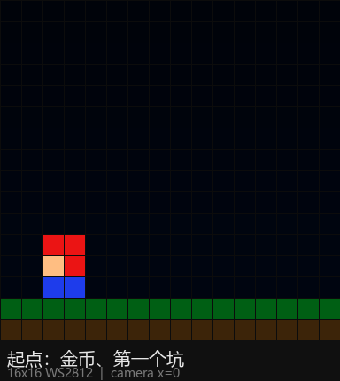
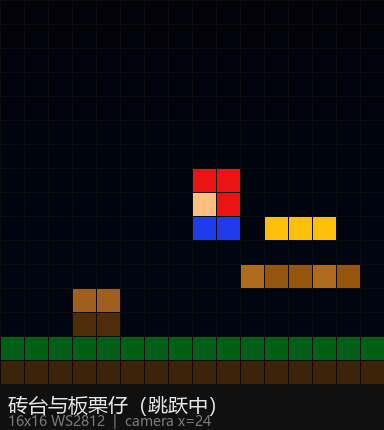
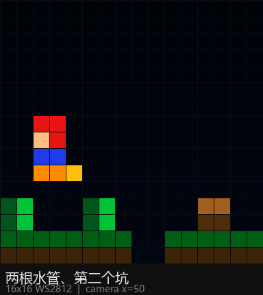
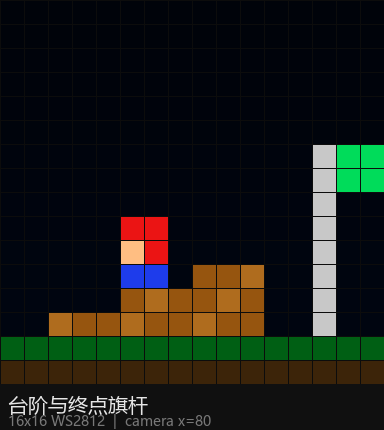

# 16×16 WS2812 灯板 · 超级马里奥（手机蓝牙手柄）

在 16×16 的 WS2812 灯板上跑的横版卷轴马里奥：手机打开一个网页当手柄，通过 BLE 把
按键发给 ESP32，板子实时推帧。整套东西和 `finger_tip_stream.py` 是同一套路子——
ESP32 收 JSON/短命令，灯板按坐标映射显示。



| 砖台与板栗仔 | 水管与坑 | 台阶与旗杆 |
| --- | --- | --- |
|  |  |  |

> 预览图由 `tools/preview.py` 按固件里的关卡和配色渲染，1 格 = 1 颗灯。

---

## 目录结构

```
mario16/
├── firmware/mario16/
│   ├── mario16.ino        # Arduino 固件：FastLED + BLE + 串口命令
│   ├── mario_game.h       # 游戏引擎接口（与硬件无关，方便塞进别的固件）
│   ├── mario_game.cpp     # 物理、敌人、渲染、所有画面
│   └── mario_level.h      # 关卡字符画（由 tools/build_level.py 生成）
├── phone/
│   └── controller.html    # 手机网页手柄（Web Bluetooth，单文件）
├── tools/
│   ├── build_level.py     # 改关卡并重新生成 mario_level.h
│   ├── preview.py         # 把关卡渲染成 PNG 预览
│   └── keyboard_serial.py # 用电脑键盘 + USB 串口试玩 / 调试
└── docs/                  # 预览图
```

---

## 1. 硬件与接线

| 元件 | 说明 |
| --- | --- |
| 主控 | ESP32-S3（推荐）或普通 ESP32、ESP32-C3；需要带 BLE |
| 灯板 | 16×16 = 256 颗 WS2812B，5V 供电，DIN 数据输入 |
| 电源 | 独立 5V 电源，**≥ 5A** 更稳（256 颗全白约 15A，固件默认亮度 60/255） |

```
       5V 电源 ──┬─────────────── 灯板 5V
                 ├─ 1000uF 电解电容（跨在灯板 5V/GND 上）
                 └─ GND ───────── 灯板 GND
ESP32 GND ──────────────────────── 5V 电源 GND   ← 必须共地
ESP32 GPIO4 ──[330Ω]───────────── 灯板 DIN
```

要点：

* **数据线串 330Ω**，靠灯板端并 1000uF，能避免上电瞬间烧第一颗灯。
* ESP32 是 3.3V 电平，多数 WS2812B 能直接识别；如果灯闪、错色，加一片
  74HCT245/74AHCT125 做 3.3V→5V 电平转换。
* 灯板数据方向别接反（DIN 是输入，DOUT 是输出）。
* 手机和板子的距离别太远，2.4G 天线旁边别堆金属。

---

## 2. 烧录固件

### 2.1 Arduino IDE 准备

1. 安装 **Arduino IDE 2.x**，在“开发板管理器”安装 **esp32 by Espressif Systems**
   （3.x 已在本地实际编译验证；2.0.x 的 API 分支也做了兼容）。
2. 在“库管理器”安装 **FastLED**（3.6 以上）。
3. 打开 `firmware/mario16/mario16.ino`。

### 2.2 板型设置（以 ESP32-S3 为例）

| 选项 | 值 |
| --- | --- |
| Board | ESP32S3 Dev Module |
| USB CDC On Boot | Enabled（用原生 USB 口烧录/看日志时） |
| Flash Size | 按你的模组选（4MB/8MB/16MB） |
| PSRAM | 不用开 |
| Upload Speed | 921600 |

普通 ESP32 选 “ESP32 Dev Module”，ESP32-C3 选 “ESP32C3 Dev Module”。

### 2.3 改引脚/灯板方向

固件开头就是配置区，用 `#define` 改：

```cpp
#define LED_PIN 4            // 灯板 DIN 接的 GPIO
#define LED_BRIGHTNESS 60    // 0-255
#define MATRIX_SERPENTINE 1  // 1 = 蛇形走线（大多数 16x16 面板）
#define MATRIX_FLIP_X 0      // 左右镜像
#define MATRIX_FLIP_Y 0      // 上下镜像
#define BUZZER_PIN -1        // 有蜂鸣器就填 GPIO，没有填 -1
```

烧好后板子会广播 BLE 设备 **MARIO16**，屏幕上（灯板上）是标题画面。

### 2.4 校准灯板方向（很重要）

不少 16×16 面板是“蛇形 + 从右上角开始”，直接跑会出现斜纹/镜像。用测试图案校准：

* 手机页面点 **灯板测试**，或者用串口发：

```
#T
```

* 正常应该是：**左上红、右上绿、左下蓝、右下白**，还有一条对角线在扫。
* 上下反了 → `MATRIX_FLIP_Y 1`
* 左右反了 → `MATRIX_FLIP_X 1`
* 不是红绿蓝四块，而是斜条纹/整片乱色 → 改 `MATRIX_SERPENTINE`（0/1 都试一下）
* 组合不对就同时翻 FLIP，四种组合试完一定能对。

---

## 3. 手机端：网页手柄

`phone/controller.html` 是单文件网页，用 **Web Bluetooth** 连板子，不需要装 App。

### 3.1 打开方式（Web Bluetooth 必须 HTTPS）

浏览器只在**安全上下文**里允许蓝牙，三种可行方式：

1. **托管到 HTTPS 静态站（最省事）**：把 `controller.html` 拖到
   GitHub Pages / Cloudflare Pages / Netlify Drop / Vercel 任意一个，手机打开那个链接。
2. **电脑本地服务 + HTTPS 隧道**：在 `phone/` 目录跑
   `python -m http.server 8000`，再 `cloudflared tunnel --url http://localhost:8000`
   得到 https 地址，手机打开。
3. **Android Chrome 的临时开关**（离线可用，仅调试）：
   访问 `chrome://flags/#unsafely-treat-insecure-origin-as-secure`，
   把 `http://电脑IP:8000` 加进去并启用，然后手机打开该地址。

iOS 的 Safari 不支持 Web Bluetooth，用 **Bluefy** 浏览器打开同一页面即可。

### 3.2 连接

1. 板子上电，灯板出现标题画面。
2. 网页点 **连接灯板** → 在弹窗里选 **MARIO16**。
3. 连上后顶部圆点变绿、显示设备名，手机同时会显示分数/生命/金币/进度。
4. 断开后网页会自动重连几次；长时间不用可以点右上角“断开”。

### 3.3 按键

| 按钮 | 作用 |
| --- | --- |
| ◀ ▶ | 左右移动 |
| ▲ | 跳跃（和 A 一样） |
| ▼ | 快速下落 |
| A（绿） | 跳跃，按住跳得更高 |
| B（红） | 加速跑，助跑能跳过更宽的坑 |
| START | 开始 / 暂停 |
| 重开 | 回到标题重新开局 |
| 灯板测试 | 显示校准图案（6 秒后自动返回） |
| 亮度 | 实时调灯板亮度 |

电脑上也可以用键盘试：方向键移动、空格跳、Shift 跑、Enter 开始。键盘只是网页里
的调试入口，最终还是走 BLE。

---

## 4. 玩法与规则

* 3 条命，掉进坑里或碰到板栗仔扣 1 条命；命用完 → `GAME OVER`。
* 金币 +100，踩板栗仔 +200，到终点旗杆 +500。
* 每关 96 格宽（6 屏），左右卷轴，摄像机平滑跟随。
* 三个坑（2 格宽）和两根水管需要跳；砖台上方的金币要跳起来吃。
* 通关后显示 `WIN` 和本关金币数，4 秒后回标题；按 A 可以立刻重开。
* 标题画面是滚动的 `SUPER MARIO 16 * PRESS A TO START *`。

所有画面都是 16×16 全屏，不额外占用 HUD 行；分数/金币/命数通过 BLE 通知显示在手机页面上。

---

## 5. BLE 协议

用的是最常见的 **Nordic UART Service (NUS)**，所以任何 BLE 串口 App 都能连：

| 用途 | UUID |
| --- | --- |
| 服务 | `6E400001-B5A3-F393-E0A9-E50E24DCCA9E` |
| 手机 → 板子（write / write no response） | `6E400002-B5A3-F393-E0A9-E50E24DCCA9E` |
| 板子 → 手机（notify） | `6E400003-B5A3-F393-E0A9-E50E24DCCA9E` |

### 5.1 手机 → 板子

短命令（网页用的就是这套，3 个字节，不怕 MTU 小）：

| 命令 | 含义 |
| --- | --- |
| `L1` / `L0` | 左 按下 / 松开 |
| `R1` / `R0` | 右 按下 / 松开 |
| `U1` / `U0` | 上（跳）按下 / 松开 |
| `D1` / `D0` | 下 按下 / 松开 |
| `A1` / `A0` | 跳跃 按下 / 松开 |
| `B1` / `B0` | 加速跑 按下 / 松开 |
| `S1` / `S0` | 开始/暂停 |
| `X1` / `X0` | 选择键（预留） |
| `#R` | 回到标题重开 |
| `#P` | 暂停 / 继续 |
| `#T` | 灯板测试（6 秒） |
| `#B80` | 亮度 0–255 |
| `#?` | 立刻回一条状态 |

JSON 写法（和 `light_controller.send_json` 完全兼容，方便手打/调试）：

```json
{"cmd":"key","k":"left","v":1}
{"cmd":"bright","v":80}
{"cmd":"reset"}
{"cmd":"pause"}
{"cmd":"test"}
{"cmd":"ping"}
```

`k` 可选：`left` `right` `up` `down` `a`/`jump` `b`/`run` `start` `select`。

### 5.2 板子 → 手机

每 250 ms 一条通知，JSON 一行：

```json
{"s":1200,"l":3,"c":5,"st":2,"p":18}
```

| 字段 | 含义 |
| --- | --- |
| `s` | 分数 |
| `l` | 剩余命 |
| `c` | 金币 |
| `st` | 0 标题 1 准备 2 游戏中 3 暂停 4 死亡 5 结束 6 通关 |
| `p` | 关卡进度 0–100 |

---

## 6. USB 串口调试（不用手机也能玩）

固件同时监听 USB 串口（115200 波特率），命令和 BLE 完全一样：

```
L1          ← 往左
A1          ← 跳
A0
#T          ← 灯板测试
```

用 Arduino 串口监视器（记得选“换行符 NL”）或者：

```bash
pip install pyserial
python tools/keyboard_serial.py --port COM5
```

这个脚本和你项目里的 `light_controller` 也能对接：

```bash
python tools/keyboard_serial.py --controller
```

> 说明：`light_controller` 默认协议是 `{"cmd":"track",...}` 那套，本固件额外认
> `{"cmd":"key",...}`；如果你的 `light_controller` 有白名单校验，把 `key` 命令加进去即可。

---

## 7. 改关卡

关卡是一张 16 行 × 96 列的字符画，存放在 `firmware/mario16/mario_level.h`：

```
'.' 空气   '#' 地面   '=' 砖台   'p' 水管
'o' 金币   'g' 板栗仔（左上角）  'S' 出生点   'F' 旗杆
```

两种改法：

1. **直接手改** `mario_level.h` 里的字符串，每行必须正好 `LEVEL_W`（96）个字符；
2. **改生成脚本**：编辑 `tools/build_level.py` 里的 `PITS / PIPES / PLATFORMS / COINS /
   GOOMBAS / STAIRS / FLAG_COL`，然后：

```bash
python tools/build_level.py     # 重新生成 mario_level.h，并做合法性检查
python tools/preview.py         # 顺手渲染几张 PNG 看看效果
```

物理参数在 `mario_game.cpp` 顶部：重力 `GRAV`、跳跃 `JUMP_V`、走/跑速度、敌人速度，
想改成“更飘”或“更硬核”都调这里。

---

## 8. 集成到现有固件（26 种模式的那套）

`mario_game.h/.cpp` 不依赖 FastLED、不依赖 Arduino，可以当成一个“27 号模式”塞进去：

```cpp
#include "mario_game.h"

static mario16::Game mario;
static bool marioInited = false;

// 进入 27 号模式时
void enterMarioMode() {
  if (!marioInited) {
    mario.begin();
    marioInited = true;
  }
}

// 每一帧（mode == 27）
void updateMario(float dt, uint16_t keysDown, uint16_t keysPressed) {
  mario16::Input in;
  in.down = keysDown;
  in.pressed = keysPressed;
  mario.update(dt, in);

  uint8_t fb[16 * 16 * 3];
  mario.render(fb);
  for (int y = 0; y < 16; ++y) {
    for (int x = 0; x < 16; ++x) {
      const uint8_t* p = fb + (y * 16 + x) * 3;
      leds[XY(x, y)] = CRGB(p[0], p[1], p[2]);
    }
  }
}
```

按键位用现成的 `mario16::KEY_LEFT / KEY_RIGHT / KEY_A / KEY_START` 拼即可；
音效是 weak 的 `void mario16Sound(uint8_t id)`，你在固件里重写它就能接蜂鸣器
（`mario16.ino` 里有示例）。

---

## 9. 常见问题

**灯板只有第一颗亮 / 完全不亮**
数据线接反（DIN/DOUT）、GPIO 号写错、没共地、5V 电源不够。先确认第一颗灯有没有微亮。

**画面是斜条纹或乱色**
蛇形/逐行不匹配：改 `MATRIX_SERPENTINE`。再不行用 `#T` 测试图案对照红绿蓝四块。

**画面上下颠倒 / 左右镜像**
改 `MATRIX_FLIP_X` / `MATRIX_FLIP_Y`，四个组合总有一个对。

**颜色偏了（红绿互换）**
FastLED 模板里的 `GRB` 改成 `RGB` 或 `BRG`。

**手机搜不到 MARIO16**
确认板子已上电且串口打印“广播中”；安卓 Chrome 需要开启定位（系统要求）；
iOS 用 Bluefy；距离拉近；板子重启一次。

**网页连上但按键没反应**
看串口日志有没有收到命令；确认手机页面是 HTTPS；按键是“按下/松开”两个事件，
如果一直按住不动也没事，松开会发 `X0`。另外 BLE 断开后固件会自动暂停游戏，
重新连上会继续。

**画面卡顿 / 手机连不上**
亮度调低（`#B60`），或把 `loop()` 里的 20000µs 改成 30000µs（约 33fps）。
FastLED 刷新 256 颗灯本身要 7~8ms，帧率别拉太满。

**想换更大/更小的屏**
本工程按 16×16 写死了视口；换 32×32 需要改 `kPanelW/kPanelH`、关卡宽度和
`XY()` 的映射，引擎里大部分常量都来自这几个宏。

---

## 10. 和 finger_tip_stream.py 的关系

`finger_tip_stream.py` 是“PC 摄像头 → MediaPipe → 串口 JSON → 灯板光点”，
本工程是“手机 BLE → 灯板马里奥”，两者共用同一条思路：

* 板子只负责收命令、刷灯；
* 上层（PC 脚本 / 手机网页）负责产生交互数据；
* JSON 协议保持 `{"cmd": ...}` 风格，`light_controller.send_json` 可以直接复用。

所以你可以让两个玩法共存：固件里保留 26 号指尖追踪模式，把马里奥做成 27 号模式，
用手机页面或串口命令切换即可。

---

MIT License · 玩得开心 🍄


