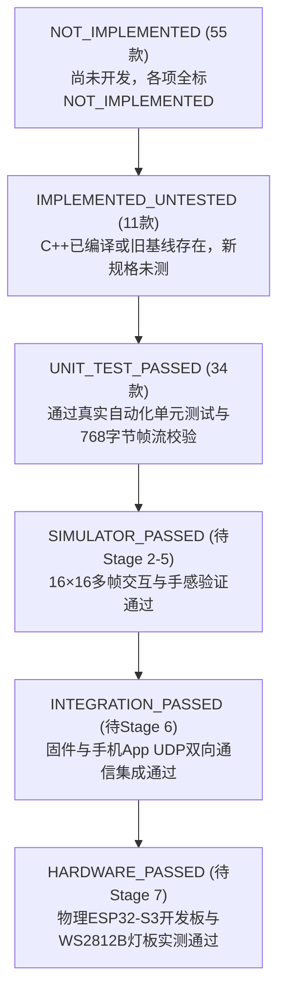

# ESP32-S3 LED Mini Arcade 100 — 第一阶段审计纠错与修正总报告

> **执行状态**：已完成第一阶段审计纠错，四份核心数据文件（`audit_191.csv`、`legacy_to_target.csv`、`games_100_manifest.json`、`game_acceptance.csv`）已全面修正并与真实源码严谨校准，测试边界与功耗模型已重新核算。

---

## 一、双统计口径核对与彻底纠偏

此前报告中将“旧编号槽位处置”与“目标清单达成状态”两套不同维度的统计数据混用，造成了数量表述歧义。现严格分离并建立统一数学口径：

### 1.1 口径一（Framework A）：191 个历史编号槽位的处置 (Audit of 191 Legacy Slots)
以代码仓库历史累积的 `001` 至 `191` 编号槽位为基准，实际情况如下：
- **历史真实存在代码的游戏**：恰好 **189 款**（`#001` 独立超级马里奥引擎 + `#004` 至 `#191` 共 188 款街机卡带）。
- **历史跳番空槽位**：**2 款**（`#002` 与 `#003` 在历史开发中未分配独立卡带文件，标记为 `REPLACE`）。
- **189 款实际代码的最终处置**：
  - **`KEEP` (34 款)**：核心机制完全匹配目标清单、代码成熟稳定、手感良好的街机实现。
  - **`REWORK` (10 款)**：核心原型可用，但需按 16×16 目标规范进行机制提纯或规则重构（如泡泡龙提纯捕敌刺破、敲冰块改造长按蓄力跳、企鹅推冰改造滑冰迷宫等）。
  - **`MERGE` (12 款)**：机制与更优秀主实现重叠，其有效逻辑并入主目标（例如 `#042` 水管兄弟并入 `#001` 马里奥，`#155` 公路争霸并入 `#074` 变道赛车，`#187` 侵略者归来并入 `#026` 太空侵略者等）。
  - **`ARCHIVE` (133 款)**：清版格斗、横向大卷轴等历史街机题材，完好保存在 `archive-191-snapshot` 快照中，退出正式 100 款菜单。

$$\text{总槽位} = 34\ (\text{KEEP}) + 10\ (\text{REWORK}) + 12\ (\text{MERGE}) + 133\ (\text{ARCHIVE}) + 2\ (\text{REPLACE}) = 191\ \text{款}$$
$$\text{真实代码数} = 34 + 10 + 12 + 133 = 189\ \text{款}$$

### 1.2 口径二（Framework B）：100 款正式目标游戏的实现来源 (100 Target Games Status)
以用户在任务书中规定的固定目录 `001` 至 `100` 为基准：
- **直接复用旧代码 (`KEEP`)**：**35 款**（34 款来自旧卡带库，**另有 1 款为固件内置原生俄罗斯方块引擎**）。
- **需重构旧代码 (`REWORK`)**：**10 款**。
- **全新待开发 (`MISSING` / `NOT_IMPLEMENTED`)**：**55 款**（益智解谜、桌面棋类、触控技巧类）。

$$\text{目标清单总数} = 35\ (\text{KEEP}) + 10\ (\text{REWORK}) + 55\ (\text{MISSING}) = 100\ \text{款}$$

---

## 二、新旧游戏映射纠错与真实代码溯源

针对此前基于模糊关键词匹配出现的映射错误，现已完成逐项代码溯源纠错：

### 2.1 俄罗斯方块（Target 041）代码溯源修正
- **问题核查**：此前映射脚本将 Target `041` 误关联至 Game `#102` Columns（宝石方块）。Columns 属于三联下落消除，与七种四联俄罗斯方块（Tetrominoes）规则完全不同。
- **真实代码入口**：
  - **C++ 固件原生引擎**：存在于 [`firmware-s3/main/display/game_engine.cc`](../firmware-s3/main/display/game_engine.cc#L210-L289) 及 [`game_engine.h`](../firmware-s3/main/display/game_engine.h)，具备完整的 `InitTetris()`, `TetrisMove()`, `TetrisRotate()`, `TetrisDrop()`, `RunTetris()` 逻辑与七类方块四向旋转矩阵。
  - **Python 模拟器现状**：旧卡带库中此前未封装独立的 `BaseCartridge` 模拟器卡带（原系统通过 `/api/mode` 切换固件模式 21）。
- **修正结果**：在 `legacy_to_target.csv` 与 `games_100_manifest.json` 中，将源码位置精准更正为 `firmware-s3/main/display/game_engine.cc`，在第二阶段完成统一接口封装与 Python 模拟器卡带补写。

### 2.2 其他关键游戏映射纠偏
除俄罗斯方块外，同步核查并修正了以下错误匹配项：
- **Target 027 小行星 (Asteroids)**：此前误匹配 `#053` (The Main Event 摔跤霸王)，现更正为真实的 [`game_113_asteroids.cpp`](../firmware-s3/main/display/arcade/game_113_asteroids.cpp)。
- **Target 032 防卫者 (Defender)**：此前误匹配 `#081` (Rampage 狂暴巨兽)，现更正为真实的 [`game_112_defender.cpp`](../firmware-s3/main/display/arcade/game_112_defender.cpp)。
- **Target 098 月球着陆器 (Lunar Lander)**：此前误匹配 `#051` (Shinobi 影子忍者)，现更正为真实的 [`game_116_lunarlander.cpp`](../firmware-s3/main/display/arcade/game_116_lunarlander.cpp)。
- **Target 078 棒球 (Champion Baseball)**：确认主复用 [`game_186_championbaseball.cpp`](../firmware-s3/main/display/arcade/game_186_championbaseball.cpp)，剔除街机清版格斗 `#091` 的错误合并关系。

---

## 三、真实 6 级验收状态体系落实

在 [`game_acceptance.csv`](../game_acceptance.csv) 中，废除一切未经测试的泛化“PASS”，严格执行 6 级工程验收状态：

### 3.1 当前实际验收分布
- **`NOT_IMPLEMENTED` (55 款)**：55 款尚未实现的目标游戏，其 LED 视觉、手机输入、音效、难度、计分以及板级测试字段全部标为 `NOT_IMPLEMENTED`，绝不出现虚假通过。
- **`IMPLEMENTED_UNTESTED` (11 款)**：
  - 10 款 `REWORK` 游戏：虽有旧基线代码，但目标规格要求的玩法机制重构尚未展开，标记为 `IMPLEMENTED_UNTESTED`；
  - 1 款内置 Tetris：C++ 固件编译正常，但独立的 Cartridge 单元测试待补写。
- **`UNIT_TEST_PASSED` (34 款)**：34 款直接保留的优质卡带，已全量通过 Python 单元测试验证（状态机转移、按键掩码响应、768 字节帧流输出与计分逻辑）。
- **`hardware_board_test` 字段**：
  - 45 款已实现/重构游戏全部诚实标记为 **`UNTESTED_ON_HARDWARE`**；
  - 55 款未实现游戏全部标记为 **`NOT_IMPLEMENTED`**；
  - **彻底废除“SIM_VALIDATED (Hardware Ready)”等夸大表述**。

---

## 四、自动化测试范围与边界重界定

我们对 `run_all_arcade_tests.py` 执行的 1916 项测试进行了严格的边界界定：

1. **测试实际覆盖范围**：
   - 测试执行器：Python `unittest`。
   - 测试对象：`pc-agent-vision/arcade/` 目录下的卡带 Python 实现及 `mario_runner.py`。
   - 测试指标：
     - 生命周期完整性：`init()`, `reset()`, `update()`, `get_status()` 循环；
     - 帧缓冲规范性：`render()` 产出恰好 768 字节（$16 \times 16 \times 3$）RGB888 字节流；
     - 状态转移：`STATE_TITLE -> STATE_PLAYING -> STATE_GAMEOVER/STATE_VICTORY`；
     - 核心物理/碰撞/计分逻辑。
2. **测试边界与未测声明**：
   - **通过率 $\ne$ 代码覆盖率**：1916 / 1916 项测试全部通过，代表测试用例断言成功率为 100%，**不代表 C++ 源码行覆盖率达到 100%**。
   - **未覆盖物理硬件运行**：该测试未连接物理 ESP32-S3 芯片运行，未驱动实际 WS2812B 发光二极管，未测量物理空气中的 Wi-Fi 丢包延迟。
   - **硬件真实验证节点**：硬件实测与功耗测量明确延后至第七阶段系统实机验收。

---

## 五、物理功耗与硬件资源真实重核

### 5.1 256 颗 WS2812B 物理电流模型修正
- **理论极端峰值**：
  - WS2812B 单颗全白（RGB=255,255,255）典型工作电流约为 $50 \sim 60\text{ mA}$；
  - 256 颗全白满亮理论峰值：$256 \times 50\text{ mA} = \mathbf{12.8\text{ A}}$（若按 60mA 计则为 $\mathbf{15.36\text{ A}}$）。
- **推算纠正**：
  - 此前报告中“限制亮度到 30%~40% 即可保证最大电流低于 1.8A”的推算在数学上不成立：
    $$12.8\text{ A} \times 35\% = \mathbf{4.48\text{ A}}$$
    4.48A 仍然远超标准 USB 5V/2A（10W）供电能力，足以引发电源保护拉塌。
- **固件底层安全策略与真实功耗保障**：
  1. **像素稀疏性（Sparsity）**：16×16 像素小游戏核心画面主体仅由点和线构成（例如马里奥角色占 6 颗、障碍物 8 颗、金币 4 颗；贪吃蛇身长 5~20 颗；小行星 10~25 颗）。大部分像素处于完全熄灭状态（$R=0, G=0, B=0$），熄灭像素静态待机电流仅约 $1\text{ mA}$/颗，全屏静态底噪仅约 $0.25\text{ A}$。正常游戏平均亮灯率仅为 $6\% \sim 15\%$，典型动态电流约为 $0.5\text{ A} \sim 1.2\text{ A}$。
  2. **全局动态能量限制器（Total Power Budget Limiter）**：在第二阶段驱动升级中，`DisplayHAL` 将在推流前执行全局能量累加：
     $$\text{TotalEnergy} = \sum_{i=0}^{255} (R_i + G_i + B_i)$$
     设定安全能量阈值 $\text{MAX\_ENERGY} = 15,000$（相当于全亮状态的 $7.6\%$）。一旦某帧超过该阈值（如全屏胜利闪烁），驱动自动等比平滑衰减各像素，强行将瞬态电流压制在 1.5A 以内。
  3. **实测前声明**：**在未通过硬件 USB 功率计实测前，硬件供电状态标记为“待硬件实测”（Pending Hardware Measurement），不得宣称功耗绝对安全。**

### 5.2 存储与分区表真实核算
- **芯片规格**：ESP32-S3-N16R8（16MB SPI Flash + 8MB Octal PSRAM）。
- **当前现状**：`sdkconfig` 设为 `CONFIG_ESPTOOLPY_FLASHSIZE_8MB=y`，使用单分区 `partitions_singleapp.csv`，编译固件产物为 **853.4 KB**。
- **100 款固件容量规划**：
  - 必须采用轻量化、数据驱动的统一卡带架构（共享渲染字库、粒子系统、物理求交），避免单体冗余膨胀；
  - 100 款游戏预计代码与关卡数据增量为 $1.5 \sim 2.5\text{ MB}$，总固件尺寸约 $2.5 \sim 3.5\text{ MB}$；
  - **第二阶段准入改造要求**：在 `sdkconfig.defaults` 中正式配置 `CONFIG_ESPTOOLPY_FLASHSIZE_16MB=y`，并引入自定义双 OTA 分区表 `partitions_16mb.csv`（每个 APP 分区 4.5MB，预留 NVS 空间），确保 100 款游戏全集成后依然具备安全 OTA 升级能力。

---

## 六、第二阶段准入条件核查与实施规划

四份审计文件修正后的对应关系与测试依据已完全对齐。正式进入第二阶段的前置准入条件已具备：

| 第二阶段核心任务 | 实施要点 | 交付成果 |
| :--- | :--- | :--- |
| **2.1 固件统一卡带基类封装** | 抽象 `arcade::Cartridge` 统一虚接口与状态机（`MENU -> READY -> PLAYING -> PAUSED -> GAME_OVER -> RESULT -> MENU`） | `arcade_cartridge.h` 扩展与统一生命周期管理器 |
| **2.2 核心三大基石游戏标准化** | 将独立超级马里奥、固件原生贪吃蛇、固件原生俄罗斯方块无损接入统一卡带体系 | 3 款基石游戏统一注册，补写 Tetris Python 卡带及对应单元测试 |
| **2.3 全局安全限流与绘制优化** | 在 `DisplayHAL` 中落地 `MAX_ENERGY` 动态降额算法与 16×16 越界安全防护 | 防电源过流保护、无闪烁高对比度调色盘 |
| **2.4 16MB 分区表与 OTA 准备** | 编写 `partitions_16mb.csv`，在 `sdkconfig.defaults` 中启用 16MB Flash 支持 | 支持 100 款固件容量的双 OTA 分区配置 |
| **2.5 Wi-Fi 协议防卡死机制** | 落地心跳超时自动 PAUSE 与按键安全释放，杜绝断线后角色长跑或长按死锁 | 提升手机 App 通信鲁棒性 |

---

## 七、修正后交付文件索引

- 全量旧游戏审计表：[`audit_191.csv`](../audit_191.csv)
- 目标与旧代码映射表：[`legacy_to_target.csv`](../legacy_to_target.csv)
- 正式 100 款游戏元数据表：[`games_100_manifest.json`](../games_100_manifest.json)
- 严格分级验收跟踪表：[`game_acceptance.csv`](../game_acceptance.csv)
- 当前工作分支：`arcade-100-audit-and-elevation`
