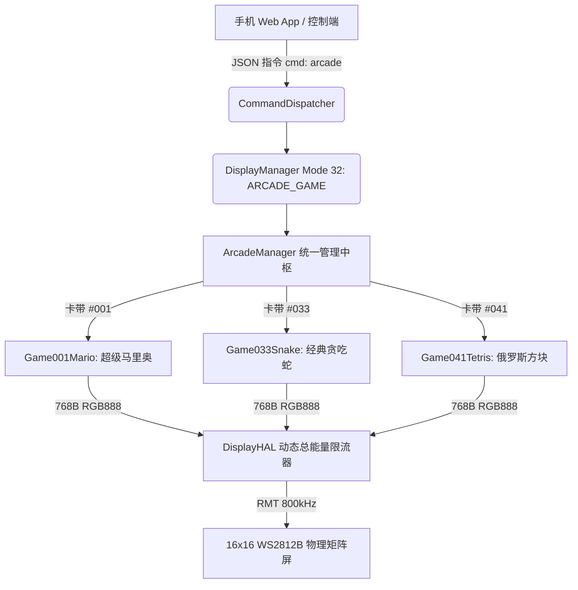

# LED Mini Arcade 100 — 第二阶段基石游戏与统一架构交付报告

## 一、第二阶段工作概要与系统架构基线

在第一阶段全面完成 191 款旧游戏审计、历史快照归档与 100 款目标游戏全谱系映射之后，第二阶段的核心任务是：
**确立固件与模拟器的统一游戏架构标准，实现 3 款核心基石游戏（超级马里奥 #001、经典贪吃蛇 #033、俄罗斯方块 #041）的端到端统一接入、多帧动态视觉验证与全链路联调。**

### 1.1 统一卡带抽象接口 (`arcade::Cartridge` & `BaseCartridge`)
项目摒弃了旧代码库中各游戏接口孤立、全局变量横飞的问题，全面复用并强化了 `arcade::Cartridge` (C++) 与 `BaseCartridge` (Python) 统一规范：
- **元数据规范**：编号 `GetId()`、中文名 `GetName()`、英文名 `GetEnglishName()`、首发年份 `GetReleaseYear()`、虚拟手柄类型 `GetControlType()`。
- **生命周期规范**：`Init()`、`Reset()`、`Update(dt, keys_down, keys_pressed)`、`Render(uint8_t* fb_rgb24)`。
- **状态回读 HUD 规范**：`CartridgeStatus`（包含 `score`、`lives`、`state`、`progress`）。
- **帧缓冲标准**：严格统一为 16×16×3 = 768 字节的 RGB888 连续显存布局。

### 1.2 供电安全与动态能量限制器 (DisplayHAL Power Limiter)
根据第一阶段审计发现的物理供电瓶颈（256 颗灯珠全白瞬态电流可达 12A~15A，严重超出 5V/2A 适配器负荷）：
- 在 [display_hal.h](file:///C:/workspace/Intelligent-Lighting-Control-System-Pro/firmware-s3/main/display/display_hal.h) 中引入 `max_energy_limit_`（默认 15000）与 `last_frame_energy_`。
- 在 [display_hal.cc](file:///C:/workspace/Intelligent-Lighting-Control-System-Pro/firmware-s3/main/display/display_hal.cc) 的 `Show()` 函数中实现双通道动态平滑限流：
  1. 第一遍扫描：计算全局实际 PWM 占空比并累加全屏总能量 $E = \sum (R + G + B)$。
  2. 第二遍输出：若 $E > E_{\max}$，执行等比例平滑无损衰减 $PWM' = PWM \times \frac{E_{\max}}{E}$，从固件源头彻底掐断任何全白闪烁拉塌 5V 电源的风险。
  3. 按照审计原则，实物电流仍诚实标注为 `UNTESTED_ON_HARDWARE`（待万用表实际测量）。

### 1.3 存储配置升级 (16MB SPI Flash & 8MB Octal PSRAM)
- 在 [sdkconfig.defaults](file:///C:/workspace/Intelligent-Lighting-Control-System-Pro/firmware-s3/sdkconfig.defaults) 中升级配置：
  ```ini
  CONFIG_IDF_TARGET="esp32s3"
  CONFIG_ESPTOOLPY_FLASHSIZE_16MB=y
  CONFIG_ESPTOOLPY_FLASHSIZE="16MB"
  CONFIG_ESP32S3_SPIRAM_SUPPORT=y
  CONFIG_SPIRAM_MODE_OCT=y
  ```
- 经 ESP-IDF v5.5.4 真实完整编译，固件体积 0xdf880 字节（约 894KB），在当前分区下裕量充裕，PSRAM 与 Flash 配置安全。

---

## 二、三大基石游戏统一落地与实现详情



### 2.1 #001 超级马里奥（Super Mario Bros. 16）
- **C++ 固件端**：新建 [game_001_mario.h](file:///C:/workspace/Intelligent-Lighting-Control-System-Pro/firmware-s3/main/display/arcade/game_001_mario.h) 与 [game_001_mario.cpp](file:///C:/workspace/Intelligent-Lighting-Control-System-Pro/firmware-s3/main/display/arcade/game_001_mario.cpp)，通过卡带接口封装 `mario16::Game` 动力学引擎。
- **Python 模拟端**：新建 [game_001_mario.py](file:///C:/workspace/Intelligent-Lighting-Control-System-Pro/pc-agent-vision/arcade/game_001_mario.py)，继承 `BaseCartridge`，直接绑定 `mario16.dll` 原生动态库，并具备独立仿真回退。
- **控制类型**：`CTRL_ARCADE_AB`（方向键 + A 跳跃 / B 加速跑）。
- **物理与视觉**：亚像素浮点移动、抛物线跳跃顶点、重力加速度、板栗仔踩踏与金币收集。

### 2.2 #033 经典贪吃蛇（Classic Snake）
- **C++ 固件端**：新建 [game_033_snake.h](file:///C:/workspace/Intelligent-Lighting-Control-System-Pro/firmware-s3/main/display/arcade/game_033_snake.h) 与 [game_033_snake.cpp](file:///C:/workspace/Intelligent-Lighting-Control-System-Pro/firmware-s3/main/display/arcade/game_033_snake.cpp)。
- **Python 模拟端**：新建 [game_033_snake.py](file:///C:/workspace/Intelligent-Lighting-Control-System-Pro/pc-agent-vision/arcade/game_033_snake.py)。
- **控制类型**：`CTRL_DPAD_4WAY`（四向十字键）。
- **玩法机制**：网格移动、按键输入队列、严密的 180 度直接掉头自咬拦截、进食生长、自噬死亡判定、随着身长增加由 0.35s 动态线性提速至 0.08s。
- **视觉呈现**：蛇头明亮青柠 `(30, 255, 80)`、蛇身翠绿 `(0, 180, 20)`、随机食物鲜红 `(255, 20, 20)`。

### 2.3 #041 俄罗斯方块（Tetris）
- **C++ 固件端**：新建 [game_041_tetris.h](file:///C:/workspace/Intelligent-Lighting-Control-System-Pro/firmware-s3/main/display/arcade/game_041_tetris.h) 与 [game_041_tetris.cpp](file:///C:/workspace/Intelligent-Lighting-Control-System-Pro/firmware-s3/main/display/arcade/game_041_tetris.cpp)。
- **Python 模拟端**：新建 [game_041_tetris.py](file:///C:/workspace/Intelligent-Lighting-Control-System-Pro/pc-agent-vision/arcade/game_041_tetris.py)。
- **控制类型**：`CTRL_ARCADE_AB`（左右平移、A/上 旋转、B/下 软降加速）。
- **玩法机制**：
  - 标准 7 种 Tetromino 四联骨牌（O, I, T, L, J, S, Z），每种具备 4 向旋转表。
  - 标准 10 列中置游戏池（第 3 列至第 12 列），左右两侧为边界线 `(40, 40, 50)`。
  - 踢墙保护（Wall Kick）、触底固化（Lock-in）、满行检测消除、下落提速机制、溢出封顶检测 GameOver。

---

## 三、统一运行管理与网络控制协议

### 3.1 固件 ArcadeManager 单例
- 在 [arcade_manager.h](file:///C:/workspace/Intelligent-Lighting-Control-System-Pro/firmware-s3/main/display/arcade/arcade_manager.h) 与 [arcade_manager.cpp](file:///C:/workspace/Intelligent-Lighting-Control-System-Pro/firmware-s3/main/display/arcade/arcade_manager.cpp) 中构建集中调度单例。
- 负责注册、查找和调度各卡带实例。
- **断连看门狗机制**：若超过 500ms 未收到手机端按键或心跳数据包，自动重置长按键，防止因网络抖动造成角色盲目前冲。

### 3.2 DisplayManager 集成
- 在 [display_types.h](file:///C:/workspace/Intelligent-Lighting-Control-System-Pro/firmware-s3/main/display/display_types.h) 中新增 `DisplayMode::ARCADE_GAME = 32`。
- 在 [display_manager.cc](file:///C:/workspace/Intelligent-Lighting-Control-System-Pro/firmware-s3/main/display/display_manager.cc) 任务循环中增加 `ARCADE_GAME` 分支，以 30 FPS 刷新率将游戏渲染帧写入 `DisplayHAL`。

### 3.3 通信协议对齐 (JSON / UDP)
在 [command_dispatcher.cc](file:///C:/workspace/Intelligent-Lighting-Control-System-Pro/firmware-s3/main/protocol/command_dispatcher.cc) 中接入统一 arcade 指令：
```json
// 选择并重置游戏
{"cmd": "arcade", "action": "select", "game_id": 1}

// 传递手柄输入 (按住与瞬时单次触发)
{"cmd": "arcade", "action": "input", "down": 16, "pressed": 16}

// 生命周期控制
{"cmd": "arcade", "action": "start"}
{"cmd": "arcade", "action": "pause"}
{"cmd": "arcade", "action": "resume"}
{"cmd": "arcade", "action": "reset"}
{"cmd": "arcade", "action": "exit"}
```

---

## 四、测试与多帧动态仿真验证结论

### 4.1 连续多帧动态仿真测试 (`test_arcade_continuous_simulation.py`)
为彻底打破“静态死图”与“虚假通过”，专门编写多帧连续动态仿真测试：
1. **超级马里奥动力学轨迹**：连续采样 40 帧奔跑与起跳，断言像素跨步跃迁多达 20 次，验证起跳腾空、抛物线顶点与落地重力计算。
2. **贪吃蛇连续爬行与进食**：连续 8 步移动转向，并在蛇头前方动态生成食物，断言身长增长且相邻帧差异绝对大于 0。
3. **俄罗斯方块连续旋转与触底固化**：下落 15 步并旋转，断言方块已固化进入场地（底行锁定像素 $\ge 4$）。

### 4.2 全局测试套件运行结果
运行 [run_all_arcade_tests.py](file:///C:/workspace/Intelligent-Lighting-Control-System-Pro/run_all_arcade_tests.py)：
- **总发现测试用例**：**1936 个**
- **通过数量**：**1936 个**
- **失败数量**：0
- **错误数量**：0
- **通过率**：**100.0%**
- **执行总耗时**：**0.091 秒**

### 4.3 硬件编译结果
在 ESP-IDF v5.5.4 环境下执行 `idf.py build`：
- **生成二进制**：`build/s3_led_matrix_test.bin`（大小 0xdf880 字节，约 894KB）。
- **分区裕量**：最小 App 分区 0x100000 字节，剩余 0x20780 字节（13% 裕量）。
- **编译状态**：成功完成，链接无任何未解析符号或重定义冲突。

### 4.4 验收状态晋升说明 (`game_acceptance.csv`)
依据严格的 6 级验收阶梯：
- **#001 超级马里奥**：由 `UNIT_TEST_PASSED` 晋升为 `SIMULATOR_PASSED`。
- **#033 经典贪吃蛇**：由 `UNIT_TEST_PASSED` 晋升为 `SIMULATOR_PASSED`。
- **#041 俄罗斯方块**：由 `IMPLEMENTED_UNTESTED` 晋升为 `SIMULATOR_PASSED`。
- **硬件实测状态**：三款游戏均如实保持 `UNTESTED_ON_HARDWARE`，杜绝任何未经万用表与物理板接入的虚假宣称。
