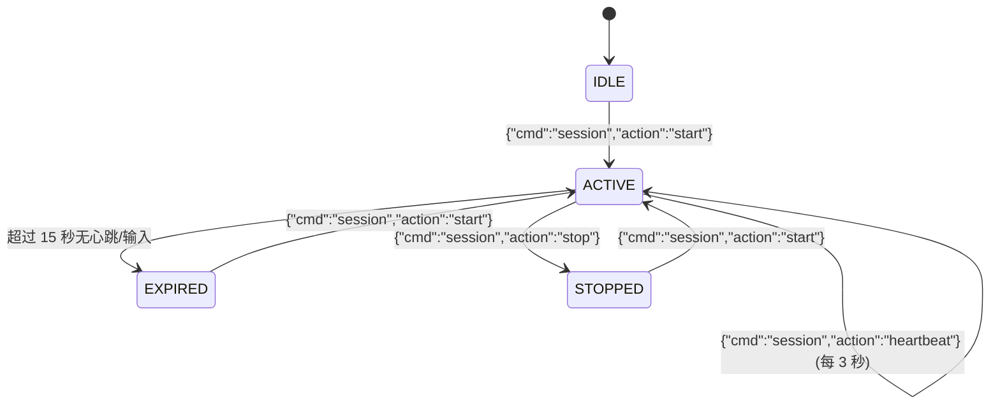

# Intelligent Lighting Control System Pro — Jetson UART 通信协议规范 (v2.3.1 Final)

**协议版本**：`2.3.1`  
**波特率**：`115200` 8N1（无硬件流控）  
**物理引脚**：
- ESP32-S3 **GPIO 8** (RXD) $\leftarrow$ Jetson Nano **Pin 8** (UART2_TXD / `/dev/ttyTHS1`)
- ESP32-S3 **GPIO 9** (TXD) $\rightarrow$ Jetson Nano **Pin 10** (UART2_RXD / `/dev/ttyTHS1`)
- **GND** $\leftrightarrow$ **Pin 6 / 9 / 14 / 20 / 25 / 30 / 34 / 39** (**必须共地**)

---

## 一、双模流协议架构 (Dual-Mode Stream)

ESP32-S3 接收端 `FrameReceiver` 采用无歧义双模状态机，同一串口线上支持**以换行符分隔的 JSON 文本行**与**固定 16 字节包头的二进制全彩画布数据包**无缝混合交替传输。

```
+-------------------------------------------------------------------------------+
|  JSON 文本模式: {"cmd":"...", ...}\n                                           |
|  二进制模式:   [0x55 0xAA 0x43 0x46] + [12B Header] + [N-Bytes Payload]        |
+-------------------------------------------------------------------------------+
```

---

## 二、二进制画布协议规范 (Binary Canvas Frame)

### 1. 二进制包头结构 (`BinaryHeader`, 16 字节小端序)
```c
#pragma pack(push, 1)
struct BinaryHeader {
    uint8_t  magic[4];       // 0x55, 0xAA, 0x43 ('C'), 0x46 ('F')
    uint8_t  type;           // 0x01: FULL_FRAME, 0x02: CHUNK, 0x03: PIXEL, 0x04: CLEAR
    uint8_t  version;        // 必须为 0x01
    uint16_t frame_seq;      // 16 位循环帧序列号 (0..65535)
    uint16_t payload_len;    // 有效载荷字节数
    uint16_t offset;         // 目标画布字节偏移 (0..767)
    uint16_t flags;          // 标志位
    uint16_t crc16;          // payload 载荷的 CRC16-CCITT 校验码
};
#pragma pack(pop)
```

### 2. 标志位与帧类型
- **Flags**:
  - `0x0001` (`FLAG_COMMIT_NOW`): 强制立即提交并呈现画面。
  - `0x0002` (`FLAG_AUTO_MODE`): 若无手动控制覆盖，自动将显示模式切为 `PIXEL_CANVAS` (29)。
  - `0x0004` (`FLAG_SKIP_CRC`): 显式免检 CRC（默认必须校验 CRC16-CCITT）。
- **BinaryType**:
  - `0x01` (`BIN_FULL_FRAME`): `payload_len` 必须恰好为 768，`offset` 必须为 0，单包直写完整 16×16 RGB888 画面。
  - `0x02` (`BIN_CHUNK_FRAME`): 分块传输，`payload_len <= 384` 且 `offset + payload_len <= 768`。
  - `0x03` (`BIN_SINGLE_PIXEL`): `payload_len == 5`，载荷为 `[x, y, r, g, b]`。
  - `0x04` (`BIN_CLEAR`): `payload_len == 0` 或 `3` (`[r, g, b]`)。

### 3. ESP32 应答回执 (ACK)
所有二进制帧均触发即时 JSON 回执：
```json
{
  "status": "ok",
  "type": "bin_frame",
  "frame_id": 42,
  "committed": true,
  "displayed": true,
  "received_bytes": 768,
  "mode_overridden": false
}
```
- `committed`: 画面数据是否成功装配入画布内存。
- `displayed`: 画面是否真正在 LED 点阵屏呈现（仅在 `committed && !mode_overridden && mode == 29` 时为 true）。
- `mode_overridden`: 用户是否在手机 App / PC Web 端锁定了人工控制模式。

---

## 三、会话生命周期与心跳机制

为了确保多进程重启、调试连接及断线恢复的健壮性，协议引入了完整的四态会话状态机：



1. **会话启动 (`action: "start"`)**:
   - `initial_seq`: 可指定初始帧序号（默认 0），ESP32 会重置序列接收状态，接纳新程序的首帧画面。
   - `mode`: 可请求切入模式（如 `"canvas"` 即 29，`"fingertip"` 即 26）。
   - 若用户正在手机端手动操作，Jetson 启动会话不会暴力抢占屏幕。
2. **周期心跳 (`action: "heartbeat"`)**:
   - Jetson 客户端每 3.0 秒自动发送一次轻量心跳，维持会话活性。
3. **会话停止 (`action: "stop"`)**:
   - 释放所有按住的游戏按键，清空脏画布缓冲。
   - 若当前处于画布模式 (29)，安全回退至彩虹波纹模式 (1)。
   - **停止后，所有迟到的旧视觉数据/画布帧均直接报错拦截 (`"session_stopped"`)**。

---

## 四、多端控制权仲裁规则

1. **用户人工控制优先**：
   - 手机 APK、PC Web、USB 控制台的指令带有用户身份标识，触发 `manual_override = true`。
   - 人工覆盖期间，Jetson 发送的自动模式切换与画布显示均被安全静默（回执中 `mode_overridden = true`，`displayed = false`），保护用户体验不被打扰。
2. **Jetson 自治运行不自锁**：
   - Jetson 通过 UART 发起的模式切换不会置位 `manual_override`，避免将自己后续的画布流锁死。
3. **显式控制权释放**：
   - 用户停止手动操作后，可通过接口或超时释放人工覆盖，Jetson 画面自动恢复正常呈现。
